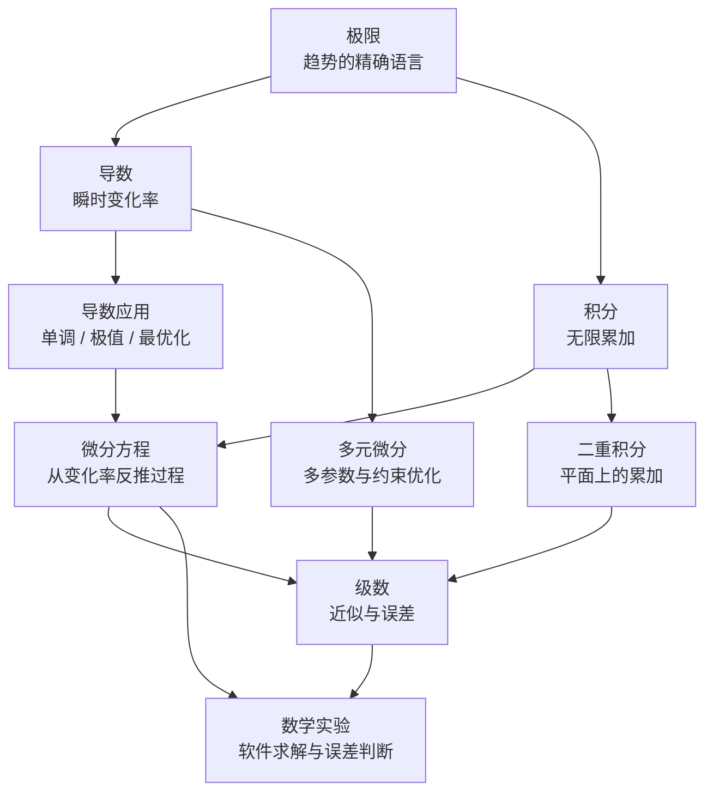

# 高等数学（食品专业版）知枢学习系统

## 这个主题在讲什么

这门课回答一个问题：怎样描述和计算"变化"。极限把"趋近"变成可检验的式子，导数给出瞬时变化率，积分把无数小份累加成总量，微分方程从变化规律反推整个过程。食品专业学它，不是为了证明定理，而是为了把冷却、发酵、降解、配方优化这些过程写成可计算、可预测的模型。

主线只有一条：**极限 → 微分 → 积分 → 微分方程 → 多元与级数 → 数值实验**。每一环都为下一环提供工具，跳过任何一环，后面的公式就只剩记忆。

## 全书心智模型

看这张图：极限在最上面，是所有分支的根。左边是"一元微积分"的主干（导数—积分—微分方程），右边是"多元与级数"的进阶，最下面是把前面所有工具落到软件和实验数据上的数学实验。食品场景贯穿在每一层，不是单独一章。

## 学习路径（推荐顺序）

| 步骤 | 章节 | 主题 | 前置 | 检查点 |
|---|---|---|---|---|
| 01 | ch01 | 函数、极限与连续 | 无 | 能算 0/0 型极限，能判断四类间断点 |
| 02 | ch02 | 导数与微分 | ch01 | 能用定义算导数，能套链式法则 |
| 03 | ch03 | 中值定理与导数应用 | ch02 | 能求单调区间、极值，能解最省料问题 |
| 04 | ch04 | 不定积分 | ch02 | 能默写基本积分表，能换元与分部 |
| 05 | ch05 | 定积分及其应用 | ch04 | 能算定积分与反常积分，能用微元法 |
| 06 | ch06 | 微分方程 | ch05 | 能解三类一阶方程与二阶常系数方程 |
| 07 | ch07 | 多元函数微分学 | ch03 | 能求偏导、全微分，能解约束优化 |
| 08 | ch08 | 二重积分 | ch07、ch05 | 能定限、换序、用极坐标 |
| 09 | ch09 | 无穷级数 | ch02、ch01 | 能判别敛散，能写泰勒展开并估误差 |
| 10 | ch10 | 数学实验与误差分析 | ch05、ch06 | 能跑数值积分与拟合，能记录有效数字 |

## 章节索引

- 第 1 章 函数、极限与连续（★☆☆）→ chapters/ch01-函数极限连续.md
- 第 2 章 导数与微分（★★☆）→ chapters/ch02-导数与微分.md
- 第 3 章 微分中值定理与导数的应用（★★☆）→ chapters/ch03-中值定理与导数应用.md
- 第 4 章 不定积分（★★☆）→ chapters/ch04-不定积分.md
- 第 5 章 定积分及其应用（★★☆）→ chapters/ch05-定积分及其应用.md
- 第 6 章 微分方程（★★★）→ chapters/ch06-微分方程.md
- 第 7 章 多元函数微分学（★★★）→ chapters/ch07-多元函数微分学.md
- 第 8 章 二重积分（★★★）→ chapters/ch08-二重积分.md
- 第 9 章 无穷级数（★★★）→ chapters/ch09-无穷级数.md
- 第 10 章 数学实验与误差分析（★★☆）→ chapters/ch10-数学实验与误差分析.md

## 前置知识（零基础缺口补讲）

| 缺口 | 补讲位置 | 学完标志 |
|---|---|---|
| 初中函数与图像 | 第 1 章「函数与复合函数」+ 概念 c01 | 能写出定义域、判断复合是否可行 |
| 指数与对数运算 | 第 1 章实例、第 2 章导数表 | 能算 $2^{t/20}$、$\ln(1+x)$ 这类式子 |
| 三角恒等式 | 第 4 章积分例题 | 能算 $\int\sin x\cos x\,dx$ |
| 分数与根式化简 | 第 1 章有理化例题 | 能处理 $\frac{\sqrt{1+x}-1}{x}$ |
| 排列组合与阶乘 | 第 9 章泰勒展开 | 能理解 $n!$ 与系数 |

## 术语表 / 模式库 / 速查表入口

- 术语表：`glossary.md`（75 条，按首现章节排列）
- 模式库：`patterns.md`（极限五级漏斗、积分三层策略、微分方程识别树、最优化四步、反模式清单）
- 速查表：`cheatsheet.md`（导数、积分、泰勒、微分方程、二重积分、级数、食品模型、误差公式）
- 测验：`quiz.md`（56 题，含 6 道综合）
- 抽认卡：`flashcards.md`（60 张）
- 学习路径详版：`paths/learn.md`
