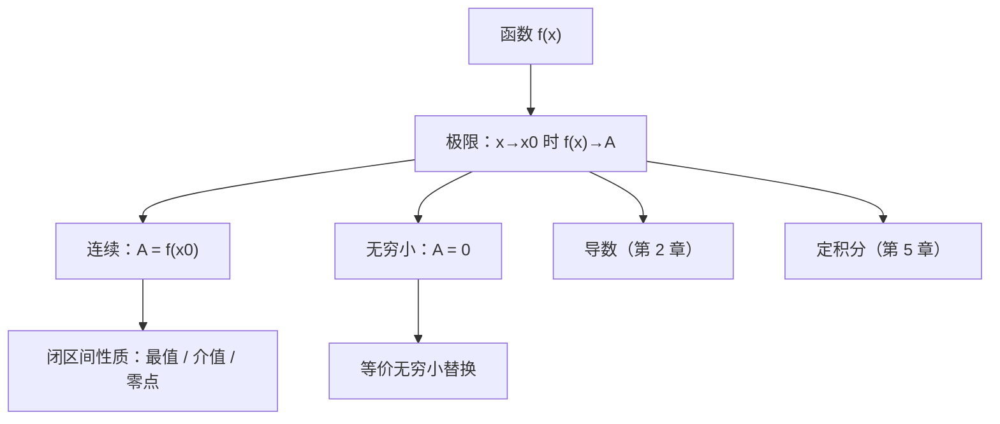

# 第 1 章：函数、极限与连续

- **难度**：★☆☆ | **预估学时**：6 小时 | **前置**：无（会初中函数与代数运算即可）

## 学习目标

学完本章，你能：

1. 判断两个函数能否复合，写出复合函数的定义域；
2. 用代入、约分、有理化、等价无穷小、重要极限五类手段算出常见极限；
3. 说清函数在一点连续要满足的三个条件，并判断四类间断点；
4. 把细菌繁殖、冷却、浓度衰减这类食品过程写成初等函数，估计它的长期趋势。

## 一句话核心

极限描述的是"越来越接近但不必到达"的趋势，导数和积分都架在它上面；连续则是极限值恰好等于函数值。

## 零基础讲解

### 概念 1：函数与复合函数（基础）

函数是"输入一个数，按固定规则输出唯一一个数"的对应关系。写成 $y=f(x)$，$x$ 叫自变量，$y$ 叫因变量，$x$ 允许取值的全体叫**定义域**。

食品专业里最常见的三类函数：

- 线性：包装成本 $C(q)=8q+1200$，$q$ 是千克数，8 元/kg 是原料单价，1200 元是固定开销。产量每多 1 kg，成本多 8 元。
- 指数：细菌数 $N(t)=100\cdot 2^{t/20}$，$t$ 为分钟。每过 20 min 翻一倍，$t=60$ 时 $N=100\cdot 2^3=800$。
- 分段：冷藏库温度设定，前 3 小时保持 4 ℃，之后升到 20 ℃。一个式子不够用，就分区间写。

**复合函数**是把一个函数的输出接到另一个函数的输入：$y=f(u)$，$u=g(x)$，合成 $y=f(g(x))$。上面那个细菌式子就能拆成 $u=t/20$ 与 $N=100\cdot 2^u$ 两层。复合的条件是内层函数的输出落在外层函数的定义域内。$\ln(\sin x)$ 要求 $\sin x>0$，也就是 $x$ 落在 $(2k\pi,(2k+1)\pi)$。

**反函数**是把输入输出倒过来。$y=2x+3$ 的反函数是 $x=(y-3)/2$。整个定义域上都能倒过来的，通常是单调函数。

### 概念 2：数列极限（高难）

数列是一列按顺序排好的数：$a_1,a_2,a_3,\dots$。说它趋近于 $A$，意思是 $n$ 越大，$a_n$ 与 $A$ 的差距可以小到任意程度——你随便报一个正数 $\varepsilon$，只要 $n$ 足够大，$|a_n-A|$ 就比 $\varepsilon$ 还小。

拿 $a_n=1/n$ 试。要误差小于 0.01，需要 $n>100$；要误差小于 0.0001，需要 $n>10000$。$\varepsilon$ 报到多小都找得到对应的 $N$，这才叫极限。

这个定义不讲"到达"，只讲"任意小"。它把"趋近"这句模糊的话换成了可以检验的不等式。第 9 章判断级数收不收敛、第 5 章定积分的"分割求和取极限"，用的都是同一套语言。

### 概念 3：函数极限与左右极限（进阶）

$x\to x_0$ 时 $f(x)\to A$：$x$ 在 $x_0$ 附近（可以不等于 $x_0$），$f(x)$ 与 $A$ 的差任意小。

从左边靠近得到**左极限** $f(x_0^-)$，从右边靠近得到**右极限** $f(x_0^+)$。极限存在的充要条件是左右极限相等。

例：$f(x)=|x|/x$。$x\to 0^+$ 时 $f=1$；$x\to 0^-$ 时 $f=-1$。左右不等，所以 $\lim_{x\to 0}|x|/x$ 不存在。

**无穷小**指极限为 0 的量，$x\to 0$ 时 $x$、$x^2$、$\sin x$、$1-\cos x$ 都是。**无穷大**指绝对值可以任意大，记作 $\infty$。它只描述趋势，不是数，不能拿来加减乘除。

### 概念 4：极限的算法与两个重要极限（进阶）

四则运算法则：若 $\lim f$ 与 $\lim g$ 都存在，则和差积商的极限等于极限的和差积商，商的分母极限不能为 0。

做题先代入。代入得到 $\frac{0}{0}$ 或 $\frac{\infty}{\infty}$ 叫**未定式**，需要变形：

- 约去公因式：$\lim_{x\to 2}\frac{x^2-4}{x-2}=\lim_{x\to 2}(x+2)=4$。
- 分子有理化：$\lim_{x\to 0}\frac{\sqrt{1+x}-1}{x}=\frac{1}{2}$。
- 等价无穷小替换（乘除因子可用）：$x\to 0$ 时
$$\sin x\sim x,\quad \tan x\sim x,\quad 1-\cos x\sim \frac{x^2}{2},\quad \ln(1+x)\sim x,\quad e^x-1\sim x,\quad \sqrt{1+x}-1\sim \frac{x}{2}$$
例如 $\lim_{x\to 0}\frac{1-\cos x}{x^2}=\frac{1}{2}$。

两个重要极限：
$$\lim_{x\to 0}\frac{\sin x}{x}=1,\qquad \lim_{x\to\infty}\left(1+\frac{1}{x}\right)^x=e$$

第二个也能写成 $\lim_{t\to 0}(1+t)^{1/t}=e$，$e\approx 2.71828$。

连续复利是它的直接应用：本金 $P$，年利率 $r$，一年分 $n$ 次计息，年末本息 $P(1+r/n)^n$；$n\to\infty$ 得 $Pe^r$。年利率 6%，$e^{0.06}\approx 1.0618$，比单利 1.06 多出 0.0018，这就是"利滚利"滚到极限的结果。

### 概念 5：连续与间断点（基础）

函数在 $x_0$ 连续要同时满足三条：

1. $f(x_0)$ 有定义；
2. $\lim_{x\to x_0}f(x)$ 存在；
3. 极限值等于函数值，$\lim_{x\to x_0}f(x)=f(x_0)$。

间断点分四类：

| 类型 | 特征 | 例子 |
|---|---|---|
| 可去 | 极限存在，但函数值不等或没定义 | $\frac{x^2-1}{x-1}$ 在 $x=1$ |
| 跳跃 | 左右极限都存在但不相等 | $\frac{\lvert x\rvert}{x}$ 在 $x=0$ |
| 无穷 | 极限为无穷大 | $\frac{1}{x}$ 在 $x=0$ |
| 振荡 | 来回摆动不趋近任何值 | $\sin\frac{1}{x}$ 在 $x=0$ |

闭区间上的连续函数有三条硬性质：一定能取到最大值和最小值；能取到两个函数值之间的任何数（介值定理）；两端函数值异号时区间内一定有零点（零点定理）。二分法求方程的根、证明"某温度下一定存在某个灭菌时间"，靠的就是这三条。

## 图示

看图说明：极限是中心节点。往下一分为二——连续（极限值等于函数值）与无穷小（极限为 0）；连续派生出闭区间三大定理；导数与定积分都从极限长出来。这张图就是整门课的地基。

## 类比与实例

类比：极限像调显微镜的焦距。你不需要"到达"那个点，只要把偏差调到任意小。失效边界：显微镜有物理极限，而数学里的 $\varepsilon$ 可以任意小，没有下限。

实例（食品）：某果汁中维生素 C 在 40 ℃ 储存，含量按 $C(t)=120e^{-0.015t}$ 下降，$t$ 为天，$C$ 为 mg/100mL。

- 第 30 天：$C=120e^{-0.45}=120\times 0.6376=76.5$ mg/100mL。
- 长期趋势：$t\to\infty$ 时 $C\to 0$，理论上一直降，实际还受氧化、光照等因素干扰。
- 问"降到 60 mg/100mL 要几天"：$120e^{-0.015t}=60$，即 $e^{-0.015t}=0.5$，$t=\ln 2/0.015\approx 46.2$ 天。

## 常见误解

- 别以为极限就是"函数取不到的那个值"——极限看的是趋近过程的终点趋势，函数在该点有没有定义、等于几，都不影响极限存在。
- 别以为等价无穷小可以随便替换——它只适用于乘除里的因子，加减法里替换会丢精度。$\lim_{x\to 0}\frac{\sin x-x}{x^3}$ 若把 $\sin x$ 换成 $x$ 会得到 0，实际答案是 $-\frac{1}{6}$。
- 别以为 $\infty$ 是一个很大的数——它只表示绝对值无限增大，写 $\infty-\infty$ 没有意义。

## 自测题（答案）

1. 单选：$\lim_{x\to 0}\dfrac{\sin 3x}{x}$ 等于（ ）（答案：C；解析：$\sin 3x\sim 3x$，比值为 3）
   - A. 0　B. 1　C. 3　D. 不存在

2. 单选：$f(x)=\dfrac{x^2-1}{x-1}$ 在 $x=1$ 处（ ）（答案：B；解析：极限为 2，但函数在 1 无定义，属可去间断点）
   - A. 连续　B. 可去间断　C. 跳跃间断　D. 无穷间断

3. 填空：$\lim_{x\to\infty}\left(1+\dfrac{2}{x}\right)^x=$ ____（答案：$e^2$；解析：令 $t=2/x$，原式 $=(1+t)^{2/t}\to e^2$）

4. 计算：某菌液初始含菌 500 CFU/mL，每 30 min 翻倍，写出 $t$ 时刻菌数并求 2 h 后的数量。（答案：$N(t)=500\cdot 2^{t/30}$；$t=120$ 时 $N=500\cdot 2^4=8000$ CFU/mL）

## 复习锚点

- 极限只看趋势不看取值，左右极限相等才算存在。
- $\frac{0}{0}$ 型四招：约分、有理化、等价无穷小、两个重要极限。
- 连续 = 有定义 + 极限存在 + 极限等于函数值。
