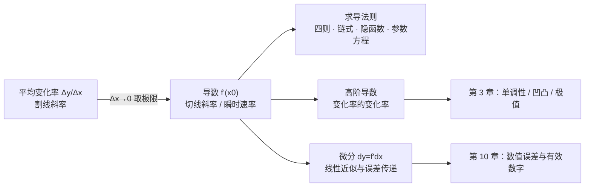

# 第 2 章：导数与微分

- **难度**：★★☆ | **预估学时**：8 小时 | **前置**：第 1 章（极限、连续）

## 学习目标

学完本章，你能：

1. 用定义算 $x^2$、$\sqrt{x}$、$1/x$ 这类函数的导数，说明可导与连续的关系；
2. 熟练套用四则法则、链式法则、隐函数求导与参数方程求导；
3. 写出函数的微分，用它做近似计算和测量误差估计；
4. 把"浓度变化率""降温速率""误差传递"翻译成导数语言并算出数值。

## 一句话核心

导数是瞬时变化率：把一段时间里的平均变化压缩到某一瞬间。可导一定连续，连续不一定可导。

## 零基础讲解

### 概念 1：从平均变化率到导数（进阶）

设函数 $y=f(x)$，自变量从 $x_0$ 变到 $x_0+\Delta x$，函数值改变 $\Delta y=f(x_0+\Delta x)-f(x_0)$。比值

$$\frac{\Delta y}{\Delta x}=\frac{f(x_0+\Delta x)-f(x_0)}{\Delta x}$$

叫**平均变化率**，几何上是两点连线的割线斜率。

让 $\Delta x\to 0$，如果这个比值的极限存在，就把它叫 $f$ 在 $x_0$ 的**导数**：

$$f'(x_0)=\lim_{\Delta x\to 0}\frac{f(x_0+\Delta x)-f(x_0)}{\Delta x}$$

记号有 $f'(x_0)$、$y'\big|_{x=x_0}$、$\frac{dy}{dx}\big|_{x=x_0}$，三种写法一个意思。

用定义算 $f(x)=x^2$ 在 $x=3$ 的导数：

$$\frac{f(3+h)-f(3)}{h}=\frac{(9+6h+h^2)-9}{h}=6+h$$

令 $h\to 0$，得 $f'(3)=6$。注意 $h$ 不能直接代 0，因为分母会变成 0，必须先约分。

导数的几何意义是**切线斜率**。曲线在 $(x_0,f(x_0))$ 处的切线方程是

$$y-f(x_0)=f'(x_0)(x-x_0)$$

专业意义是**瞬时变化率**。浓度 $C(t)$ 对时间的导数 $C'(t)$ 就是瞬时变化速率，单位是 mg/(100mL·h)；温度 $T(t)$ 的导数就是降温速率，单位 ℃/min。

左导数与右导数都存在且相等，才叫可导。$f(x)=|x|$ 在 $x=0$ 左导数为 $-1$、右导数为 $1$，不相等，所以不可导——但它在 0 点连续。反过来，可导一定连续：可导意味着 $\Delta y=f'(x_0)\Delta x+o(\Delta x)$，$\Delta x\to 0$ 时 $\Delta y\to 0$。所以可导比连续更"强"。

### 概念 2：基本导数表与四则法则（基础）

必须背下来的基本表：

$$(C)'=0,\quad (x^n)'=nx^{n-1},\quad (\sin x)'=\cos x,\quad (\cos x)'=-\sin x$$
$$(e^x)'=e^x,\quad (a^x)'=a^x\ln a,\quad (\ln x)'=\frac{1}{x},\quad (\log_a x)'=\frac{1}{x\ln a}$$
$$(\arctan x)'=\frac{1}{1+x^2},\quad (\arcsin x)'=\frac{1}{\sqrt{1-x^2}}$$

四则法则：

$$(u\pm v)'=u'\pm v',\quad (uv)'=u'v+uv',\quad \left(\frac{u}{v}\right)'=\frac{u'v-uv'}{v^2}$$

例：$y=x^2e^x$，$y'=2xe^x+x^2e^x=xe^x(2+x)$。

### 概念 3：链式法则（进阶）

复合函数求导像拆快递：一层一层剥，每剥一层乘上这一层的导数。

$$y=f(g(x))\ \Longrightarrow\ y'=f'(u)\cdot g'(x),\quad u=g(x)$$

例：$y=\ln(\sin x)$，外层是 $\ln u$，内层是 $\sin x$：

$$y'=\frac{1}{\sin x}\cdot\cos x=\cot x$$

例：$y=e^{-kt}$ 是食品里的一级反应模型，$y'=-ke^{-kt}$。这个负号就是"含量在减少"，$k$ 越大减得越快。

多层嵌套也照此办理。$y=\sin^2(3x)$：最外层平方，中间 $\sin$，最内层 $3x$。

$$y'=2\sin(3x)\cdot\cos(3x)\cdot 3=3\sin 6x$$

## 概念 4：隐函数与参数方程求导（进阶）

**隐函数**是 $y$ 没有单独解出来、藏在方程 $F(x,y)=0$ 里的情形。做法是把 $y$ 看成 $y(x)$，方程两边同时对 $x$ 求导，遇到 $y$ 就用链式法则多乘一个 $y'$。

例：圆 $x^2+y^2=25$，两边求导 $2x+2yy'=0$，得 $y'=-\frac{x}{y}$。在点 $(3,4)$ 处斜率为 $-\frac{3}{4}$，切线 $y-4=-\frac{3}{4}(x-3)$。

**参数方程** $\begin{cases}x=x(t)\\ y=y(t)\end{cases}$，则

$$\frac{dy}{dx}=\frac{dy/dt}{dx/dt}$$

例：$x=t^2,\ y=t^3$，$\frac{dy}{dx}=\frac{3t^2}{2t}=\frac{3t}{2}$。

**对数求导法**对付幂指函数。$y=x^x$ 两边取对数 $\ln y=x\ln x$，再求导：

$$\frac{y'}{y}=\ln x+1\ \Longrightarrow\ y'=x^x(\ln x+1)$$

### 概念 5：高阶导数（进阶）

导数的导数叫二阶导数，记 $y''$ 或 $\frac{d^2y}{dx^2}$。$y=e^{-kt}$ 的 $y''=k^2e^{-kt}$。

二阶导数描述"变化率本身怎么变"。冷却曲线 $T(t)$ 满足 $T'<0$（温度在降），若 $T''>0$，说明降温越来越慢——越接近环境温度，散热越慢。这正好对应牛顿冷却定律的指数衰减形状。

### 概念 6：微分与线性近似（基础）

自变量改变 $\Delta x$ 时，函数改变量的线性主部叫**微分**：

$$dy=f'(x)\,dx$$

当 $\Delta x$ 很小时，$\Delta y\approx dy$，于是

$$f(x_0+\Delta x)\approx f(x_0)+f'(x_0)\Delta x$$

例：$\sqrt{1.02}$。取 $f(x)=\sqrt{x}$，$x_0=1$，$\Delta x=0.02$，$f'(1)=\frac{1}{2}$：

$$\sqrt{1.02}\approx 1+0.5\times 0.02=1.01$$

实际 $1.00995$，误差 0.00005。

例：$e^{0.05}\approx 1+0.05=1.05$，实际 $1.05127$，误差约 0.0013。$\Delta x$ 越小，这个近似越准。

**误差传递**是微分在检测里最实用的用途。若 $y=f(x)$，$x$ 有测量误差 $\Delta x$，则

$$\Delta y\approx |f'(x)|\Delta x,\qquad \frac{\Delta y}{y}\approx\left|\frac{f'(x)}{f(x)}\right|\Delta x=\left|\frac{d\ln f}{dx}\right|\Delta x$$

例：pH 计读数 $4.20\pm 0.05$，氢离子浓度 $c=10^{-\mathrm{pH}}$。由 $\ln c=-\mathrm{pH}\ln 10$ 得 $\frac{dc}{c}=-\ln 10\,d(\mathrm{pH})$，所以相对误差约 $\ln 10\times 0.05=0.115$，即 11.5%。pH 只差 0.05，浓度就差一成多，这就是为什么 pH 计要校准。

## 图示

看图说明：左边是入口——割线斜率取极限得到导数。中间分出三条应用线：求导法则（怎么算）、高阶导数（变化率怎么变）、微分（近似与误差）。后两条分别通向第 3 章的曲线形状和第 10 章的实验数据处理。

## 类比与实例

类比：导数像汽车仪表盘上的瞬时速度。里程表给你一段路程的平均速度，速度表给你这一瞬间的速度。失效边界：仪表盘每秒采样一次，是"很短时间"的平均；数学上的导数是 $\Delta t$ 趋于 0 的极限，没有采样间隔。

实例（食品）：某批牛奶在 4 ℃ 储藏，细菌数按 $N(t)=200e^{0.08t}$ 增长（$t$ 为小时）。求第 10 小时的菌数和增长速率。

- 菌数：$N(10)=200e^{0.8}=200\times 2.2255=445$ CFU/mL。
- 增长速率：$N'(t)=200\times 0.08e^{0.08t}=16e^{0.08t}$，$N'(10)=16\times 2.2255=35.6$ CFU/(mL·h)。
- 含义：第 10 小时这个时刻，每过 1 小时大约多 36 CFU/mL。$N''>0$ 说明增长在加速，越往后越难压。

## 常见误解

- 别以为连续一定可导——$|x|$ 在 0 点连续但左右导数不等；$y=\sqrt[3]{x}$ 在 0 点连续，导数却趋于无穷。
- 别以为 $(uv)'=u'v'$——乘法法则是 $u'v+uv'$。取 $u=v=x$，$(x^2)'=2x$，而 $1\cdot 1=1$，差得远。
- 别以为导数和微分是一回事——导数是变化率（一个数或函数），微分是改变量的线性主部 $dy=f'dx$，带 $dx$。
- 别忘记单位——导数的单位是"因变量单位除以自变量单位"，菌数的导数单位是 CFU/(mL·h)，不是 CFU/mL。

## 自测题（答案）

1. 单选：$y=x^3\ln x$ 的导数为（ ）（答案：C；解析：$(uv)'=3x^2\ln x+x^3\cdot\frac{1}{x}=3x^2\ln x+x^2$）
   - A. $3x^2\ln x$　B. $x^2$　C. $3x^2\ln x+x^2$　D. $3x^2+\frac{1}{x}$

2. 单选：$f(x)=|x|$ 在 $x=0$ 处（ ）（答案：B；解析：连续但左右导数分别为 $-1$ 与 $1$，不可导）
   - A. 可导且导数为 0　B. 连续但不可导　C. 不连续　D. 可导且导数为 1

3. 填空：$\ln(1.01)$ 用微分近似为 ____（答案：0.01；解析：$\ln(1+\Delta x)\approx\Delta x$，$\Delta x=0.01$，实际 0.00995）

4. 计算：圆的面积 $S=\pi r^2$，半径 $r=10$ cm，测量误差 $\pm 0.2$ cm，求面积的绝对误差与相对误差。（答案：$S'(r)=2\pi r=62.83$，$\Delta S\approx 62.83\times 0.2=12.57$ cm²；$S=314.16$ cm²，相对误差约 4%）

5. 计算：$x^2+y^2=25$ 在点 $(3,4)$ 处的切线斜率。（答案：$-\frac{3}{4}$）

## 复习锚点

- 导数 = 平均变化率的极限；可导必连续，连续不一定可导。
- 复合函数求导：外层导数 × 内层导数，一层层剥。
- 微分做近似：$f(x_0+\Delta x)\approx f(x_0)+f'(x_0)\Delta x$；误差传递看 $\left|\frac{f'}{f}\right|\Delta x$。
