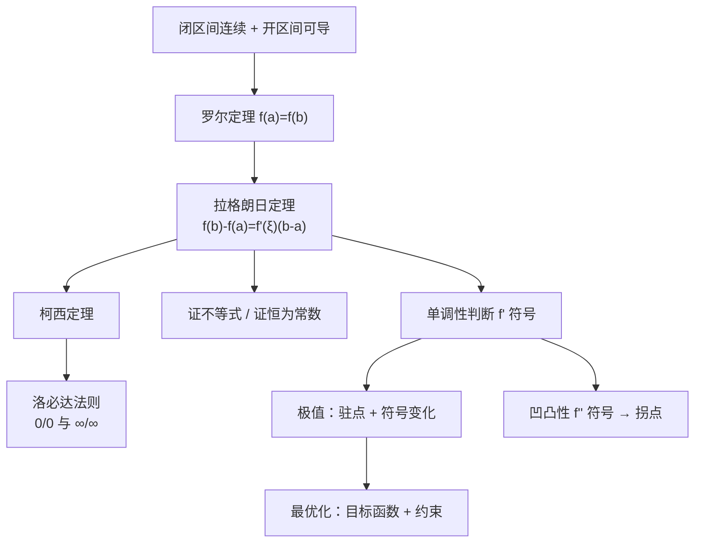

# 第 3 章：微分中值定理与导数的应用

- **难度**：★★☆ | **预估学时**：8 小时 | **前置**：第 2 章（导数、微分）

## 学习目标

学完本章，你能：

1. 说出罗尔、拉格朗日、柯西三个中值定理的条件与结论，并用拉格朗日定理证明简单不等式；
2. 判断未定式类型，用洛必达法则算出结果，并识别它失效的情形；
3. 求函数的单调区间、极值、凹凸区间与拐点；
4. 把"用料最省""成本最低""产量最大"这类实际问题建成目标函数并求解。

## 一句话核心

中值定理把"区间上的整体变化"与"某一点的瞬时变化率"绑在一起；导数的符号决定曲线的升降与弯曲方向。

## 零基础讲解

### 概念 1：罗尔定理（进阶）

如果函数 $f$ 满足三条：在闭区间 $[a,b]$ 上连续、在开区间 $(a,b)$ 内可导、两端函数值相等 $f(a)=f(b)$，那么区间内至少存在一点 $\xi$，使 $f'(\xi)=0$。

几何上很好懂：一条从同一高度出发又回到同一高度的光滑曲线，中间必然有一处切线是水平的。

例：$f(x)=x^2-4x+3$ 在 $[1,3]$ 上。$f(1)=0$，$f(3)=0$，满足条件。$f'(x)=2x-4=0$ 得 $\xi=2$，确实在 $(1,3)$ 内。

### 概念 2：拉格朗日中值定理（进阶）

把"两端等高"的条件去掉，结论变成：

$$f(b)-f(a)=f'(\xi)(b-a),\quad a<\xi<b$$

移项就是 $f'(\xi)=\dfrac{f(b)-f(a)}{b-a}$：区间上的平均变化率，一定在区间内某一点被瞬时变化率取到。

例：$f(x)=x^2$ 在 $[1,3]$ 上，平均变化率 $\frac{9-1}{3-1}=4$，令 $2\xi=4$ 得 $\xi=2$，正好在区间中点。

它的第一用途是证不等式。对 $f(x)=\sin x$ 在 $[a,b]$ 上用定理：

$$\sin b-\sin a=\cos\xi\cdot(b-a)\ \Longrightarrow\ |\sin b-\sin a|\le|b-a|$$

第二用途是判断"导数恒为 0 则函数恒为常数"。这两条在证明恒等式、推导积分常数时都要用。

### 概念 3：柯西中值定理（了解）

两个函数一起变化时：

$$\frac{f(b)-f(a)}{g(b)-g(a)}=\frac{f'(\xi)}{g'(\xi)}$$

它是一般形式，拉格朗日是 $g(x)=x$ 的特例。后面推洛必达法则就靠它。

### 概念 4：洛必达法则（进阶）

遇到 $\frac{0}{0}$ 或 $\frac{\infty}{\infty}$ 型未定式，在满足可导、分母导数不为 0、导数之比的极限存在这三个条件下：

$$\lim\frac{f(x)}{g(x)}=\lim\frac{f'(x)}{g'(x)}$$

例：$\lim_{x\to 0}\frac{e^x-1-x}{x^2}$。代入得 $\frac{0}{0}$，用一次：$\frac{e^x-1}{2x}$，仍是 $\frac{0}{0}$，再用一次：$\frac{e^x}{2}\to\frac{1}{2}$。

三个坑：

- 不是未定式不能用。$\lim_{x\to 0}\frac{\sin x}{x+1}=\frac{0}{1}=0$，硬用洛必达会算出 1。
- 导数之比的极限不存在，不代表原极限不存在。$\lim_{x\to\infty}\frac{x+\sin x}{x}$ 的导数比是 $1+\cos x$，来回振荡没有极限，但原式等于 $1+\frac{\sin x}{x}\to 1$。
- 能等价无穷小替换的先换，能约分的先约，别一路求导到底。

### 概念 5：单调性与极值（进阶）

在区间上 $f'(x)>0$，函数单调递增；$f'(x)<0$，单调递减。$f'(x)=0$ 的点叫**驻点**。

极值的判别：

- 第一充分条件：$f'$ 在 $x_0$ 左侧为正、右侧为负，$x_0$ 是极大值点；左负右正，是极小值点。
- 第二充分条件：$f'(x_0)=0$ 且 $f''(x_0)<0$，极大；$f''(x_0)>0$，极小。

例：$f(x)=x^3-3x$。$f'(x)=3x^2-3=3(x-1)(x+1)$。驻点 $x=-1,1$。

| 区间 | $(-\infty,-1)$ | $(-1,1)$ | $(1,\infty)$ |
|---|---|---|---|
| $f'$ 符号 | + | − | + |
| 单调性 | 增 | 减 | 增 |

极大值 $f(-1)=-1+3=2$，极小值 $f(1)=1-3=-2$。

注意：驻点不一定是极值点，$y=x^3$ 在 0 处 $f'=0$ 但一直递增；极值点也可能是导数不存在的点，$y=|x|$ 在 0 处取极小但不可导。

### 概念 6：最优化（进阶）

闭区间上求最值：把区间内所有驻点和不可导点算出来，连同两个端点，比较函数值，最大的就是最大值。

实际问题分四步：

1. 设变量，写出目标函数（要最小化或最大化的量）；
2. 用约束条件把变量减少到一个；
3. 求导，找驻点；
4. 判断是最大还是最小（第二导数或实际意义）。

例（食品包装）：圆柱形罐头体积 $V=500$ cm³，要表面积最小。设底面半径 $r$，高 $h=V/(\pi r^2)$，表面积

$$S(r)=2\pi r^2+2\pi rh=2\pi r^2+\frac{2V}{r}$$

求导 $S'(r)=4\pi r-\frac{2V}{r^2}=0$，得 $r^3=\frac{V}{2\pi}$，$r=\sqrt[3]{\frac{500}{2\pi}}\approx 4.30$ cm。此时 $h=\frac{500}{\pi\cdot 4.30^2}\approx 8.61$ cm，$S\approx 348.8$ cm²。$S''>0$，确为最小。罐型高约为直径的 1 倍，这就是常见的"矮胖罐"比例。

### 概念 7：凹凸性与拐点（基础）

$f''(x)>0$，曲线开口向上，叫凹（下凸）；$f''(x)<0$，开口向下，叫凸。凹凸性改变的点叫**拐点**。

例：$f(x)=x^3$，$f''=6x$。$x<0$ 时 $f''<0$（凸），$x>0$ 时 $f''>0$（凹），$(0,0)$ 是拐点。

拐点必须满足 $f''=0$ 或 $f''$ 不存在，但 $f''=0$ 的点不一定是拐点（$y=x^4$ 在 0 处 $f''=0$，两边都凹，不是拐点）。

### 概念 8：渐近线与函数作图（基础）

- 水平渐近线：$\lim_{x\to\infty}f(x)=b$，则 $y=b$。
- 铅直渐近线：$\lim_{x\to a}f(x)=\infty$，则 $x=a$。
- 斜渐近线：$k=\lim_{x\to\infty}\frac{f(x)}{x}$，$b=\lim_{x\to\infty}(f(x)-kx)$，则 $y=kx+b$。

作图顺序：定义域 → 奇偶性周期性 → 与坐标轴交点 → 单调性与极值 → 凹凸与拐点 → 渐近线 → 描点连线。

## 图示

看图说明：罗尔是根，去掉端点等高条件得到拉格朗日，再推广成柯西。柯西用于推洛必达；拉格朗日直接给出单调性判据，单调性再接极值与最优化。右边一条支线用二阶导数管弯曲方向。

## 类比与实例

类比：中值定理像高速上的平均车速。北京到天津 120 km 用了 1.5 h，平均 80 km/h；定理保证，这 1.5 h 里至少有一瞬间，速度表正好指在 80。失效边界：只保证"存在"，不告诉你在哪一刻，也不保证只出现一次。

实例（食品工厂）：某生产线每天生产 $x$ 吨产品，成本函数 $C(x)=0.5x^2+20x+800$（元），售价 120 元/吨。利润

$$L(x)=120x-(0.5x^2+20x+800)=-0.5x^2+100x-800$$

$L'(x)=-x+100=0$，$x=100$ 吨。$L''=-1<0$，是最大值。最大利润 $L(100)=-5000+10000-800=4200$ 元。若产能上限只有 80 吨，则区间端点 $x=80$ 取最大，$L(80)=-3200+8000-800=4000$ 元——约束起作用时，最优解在边界上。

## 常见误解

- 别以为 $f'(x_0)=0$ 就一定是极值点——$y=x^3$ 在 0 处导数为 0，但函数一路递增。
- 别以为极值点一定导数为 0——$y=|x|$ 在 0 处取极小，导数不存在。
- 别以为洛必达万能——不是未定式强行用会算错；导数比没有极限也不能倒推原极限不存在。
- 别把"极值"和"最值"混为一谈——极值是局部概念，最值是整个区间上的比较结果，最值可能在端点。

## 自测题（答案）

1. 单选：$f(x)=x^3-3x$ 的极大值为（ ）（答案：B；解析：$x=-1$ 处由增变减，$f(-1)=2$）
   - A. $-2$　B. 2　C. 0　D. 1

2. 单选：$\lim_{x\to 0}\dfrac{e^x-1-x}{x^2}$ 等于（ ）（答案：C；解析：两次洛必达，最后 $e^x/2\to 1/2$）
   - A. 0　B. 1　C. $\frac{1}{2}$　D. 不存在

3. 填空：$f(x)=x^3$ 的拐点是 ____（答案：$(0,0)$；解析：$f''=6x$ 在 0 两侧变号）

4. 计算：用 36 cm² 的纸板做无盖方盒，底面正方形边长 $x$，高 $h$，求容积最大时的尺寸。（答案：$x^2+4xh=36$，$h=\frac{36-x^2}{4x}$，$V=x^2h=\frac{36x-x^3}{4}$，$V'=\frac{36-3x^2}{4}=0$，$x=\sqrt{12}\approx3.46$ cm，$h=\sqrt{12}/2\approx1.73$ cm，$V\approx20.78$ cm³）

5. 判断：$f(x)=x^4$ 在 $x=0$ 处有拐点吗？（答案：没有；$f''=12x^2\ge0$，两侧都凹，只是 $f''=0$）

## 复习锚点

- 拉格朗日：平均变化率必在某点被瞬时变化率取到；可用来证不等式。
- 极值看 $f'$ 变号，最值还要比端点；应用题先建目标函数再求导。
- $f''$ 管凹凸，变号才是拐点。
