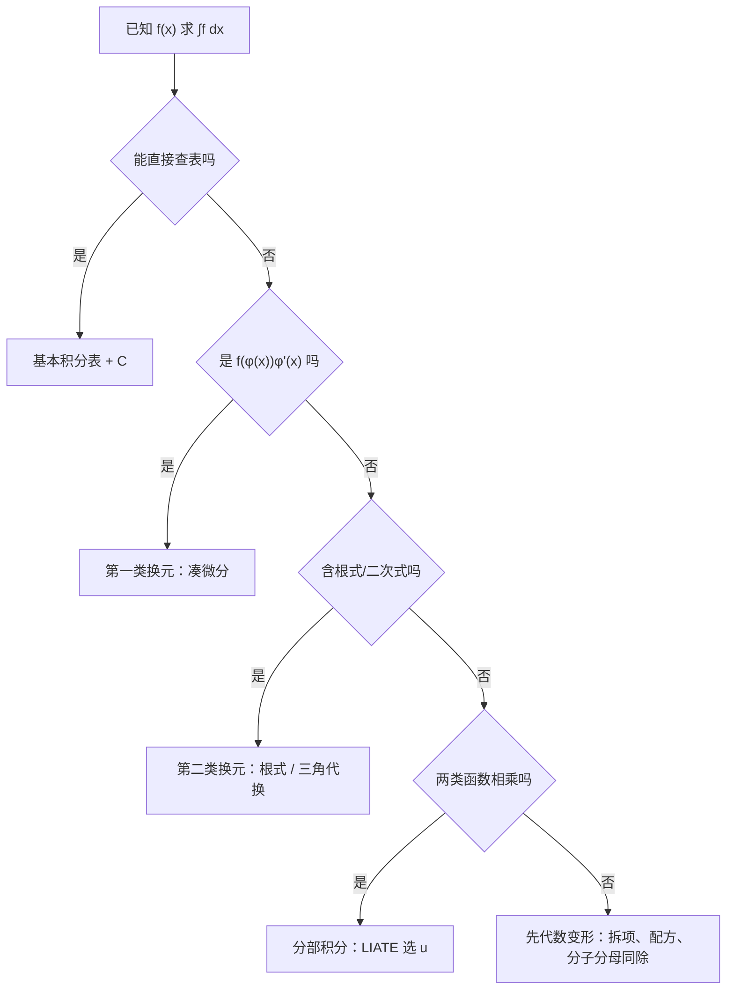

# 第 4 章：不定积分

- **难度**：★★☆ | **预估学时**：9 小时 | **前置**：第 2 章（求导法则）

## 学习目标

学完本章，你能：

1. 说出原函数与不定积分的关系，解释为什么答案后面要加 $C$；
2. 默写基本积分表，完成多项式、指数、三角、简单分式的积分；
3. 用凑微分、第二类换元、分部积分三类方法处理复合函数与乘积形式的积分；
4. 由"变化速率"反求"累积量"，解决食品中的残留量、累积产量这类问题。

## 一句话核心

不定积分是求导的逆运算：已知变化率，反求原来的函数。结果是"一族函数"，不是某一个。

## 零基础讲解

### 概念 1：原函数与不定积分（基础）

若 $F'(x)=f(x)$，就称 $F$ 是 $f$ 的一个**原函数**。因为常数的导数为 0，所以原函数不唯一：$x^2$、$x^2+1$、$x^2-100$ 的导数都是 $2x$。

把全体原函数记作

$$\int f(x)\,dx=F(x)+C$$

其中 $C$ 是任意常数，叫**积分常数**，$dx$ 表示对 $x$ 积分。$\int$ 和 $d$ 是一对逆运算：$\frac{d}{dx}\int f\,dx=f(x)$，$\int F'(x)\,dx=F(x)+C$。

求导有明确公式，积分没有万能公式。能积出来的函数其实很少，大部分要靠变形凑成基本表里的形状。

### 概念 2：基本积分表（基础）

$$∫x^n dx=\frac{x^{n+1}}{n+1}+C\ (n\ne -1),\qquad ∫\frac{1}{x}dx=\ln|x|+C$$
$$∫e^x dx=e^x+C,\qquad ∫a^x dx=\frac{a^x}{\ln a}+C$$
$$∫\sin x\,dx=-\cos x+C,\qquad ∫\cos x\,dx=\sin x+C$$
$$∫\sec^2x\,dx=\tan x+C,\qquad ∫\frac{dx}{1+x^2}=\arctan x+C$$
$$∫\frac{dx}{\sqrt{1-x^2}}=\arcsin x+C$$

每条都能用求导验证。$\int x^n$ 那条要记住 $n=-1$ 是例外：$\int x^{-1}dx=\ln|x|+C$，因为 $\ln x$ 的导数才是 $1/x$。

### 概念 3：第一类换元法（凑微分）（进阶）

若被积式能写成 $f(\varphi(x))\varphi'(x)$，令 $u=\varphi(x)$，$du=\varphi'(x)dx$，就把积分变成 $\int f(u)du$。

$$∫f(\varphi(x))\varphi'(x)\,dx=∫f(u)\,du$$

例：$\int xe^{x^2}dx$。注意到 $d(x^2)=2x\,dx$，所以 $x\,dx=\frac{1}{2}d(x^2)$：

$$∫xe^{x^2}dx=\frac{1}{2}∫e^{u}du=\frac{1}{2}e^{x^2}+C$$

例：$\int(2x+1)^5dx$。$d(2x+1)=2dx$，

$$∫(2x+1)^5dx=\frac{1}{2}\cdot\frac{(2x+1)^6}{6}+C=\frac{(2x+1)^6}{12}+C$$

例：$\int\cos 3x\,dx=\frac{1}{3}\sin 3x+C$。

例：$\int\frac{dx}{x\ln x}$。$d(\ln x)=\frac{dx}{x}$，所以等于 $\int\frac{du}{u}=\ln|\ln x|+C$。

凑微分的关键是认出新变量 $u$ 和它的微分 $du$ 同时出现在式子里。常见的配对：$x\,dx$ 配 $x^2$，$\frac{dx}{x}$ 配 $\ln x$，$\cos x\,dx$ 配 $\sin x$，$\sec^2x\,dx$ 配 $\tan x$。

### 概念 4：第二类换元法（进阶）

反过来，令 $x=\psi(t)$，把 $dx=\psi'(t)dt$ 代进去，把根式或复杂分母换成简单形式。

$$∫f(x)dx=∫f(\psi(t))\psi'(t)dt$$

三种常用代换：

- 根式代换：含 $\sqrt[n]{ax+b}$ 时令 $t=\sqrt[n]{ax+b}$。
- 三角代换：含 $\sqrt{a^2-x^2}$ 令 $x=a\sin t$；含 $\sqrt{a^2+x^2}$ 令 $x=a\tan t$；含 $\sqrt{x^2-a^2}$ 令 $x=a\sec t$。
- 倒代换：分母次数高时令 $x=1/t$。

例：$\int\frac{dx}{1+\sqrt{x}}$。令 $t=\sqrt{x}$，$x=t^2$，$dx=2t\,dt$：

$$∫\frac{2t}{1+t}dt=2∫\left(1-\frac{1}{1+t}\right)dt=2t-2\ln(1+t)+C=2\sqrt{x}-2\ln(1+\sqrt{x})+C$$

算完记得把 $t$ 换回 $x$，不定积分不能留中间变量。

### 概念 5：分部积分法（进阶）

$$∫u\,dv=uv-∫v\,du$$

它来自乘积求导公式 $(uv)'=u'v+uv'$ 的移项。适合"两类不同函数相乘"的积分。

选 $u$ 的口诀是 LIATE（对数、反三角、代数、三角、指数），排在前面的优先当 $u$，因为它求导会变简单：$\ln x$ 求导变 $1/x$，多项式求导降次，指数和三角求导循环。

例：$\int x\ln x\,dx$。取 $u=\ln x$，$dv=x\,dx$，则 $du=\frac{dx}{x}$，$v=\frac{x^2}{2}$：

$$∫x\ln x\,dx=\frac{x^2}{2}\ln x-∫\frac{x^2}{2}\cdot\frac{1}{x}dx=\frac{x^2}{2}\ln x-\frac{x^2}{4}+C$$

验算求导：$\frac{x^2}{2}\cdot\frac{1}{x}+x\ln x-\frac{x}{2}=x\ln x$，对。

例：$\int xe^xdx$。取 $u=x$，$dv=e^xdx$，得 $xe^x-\int e^xdx=(x-1)e^x+C$。

例：$\int\ln x\,dx$。取 $u=\ln x$，$dv=dx$，得 $x\ln x-x+C$。

### 概念 6：有理函数的积分（了解）

真分式 $\frac{P(x)}{Q(x)}$ 先因式分解分母，再拆成部分分式。例：

$$\frac{1}{x^2-1}=\frac{1}{(x-1)(x+1)}=\frac{1}{2}\left(\frac{1}{x-1}-\frac{1}{x+1}\right)$$

$$∫\frac{dx}{x^2-1}=\frac{1}{2}\ln\left|\frac{x-1}{x+1}\right|+C$$

这类题在专科考试里通常是简单形式，记住"拆项 + 逐项积"即可。

## 图示

看图说明：从上到下是一条决策链。先查表，不行就看结构——复合结构用凑微分，根式用第二类换元，乘积用分部积分，都不是就先做代数变形。大部分积分题卡住，是因为跳过了最后那个"先变形"的框。

## 类比与实例

类比：积分像根据速度记录反推路程。速度表记录的是每一刻的速度（导数），想知道跑了多远（原函数），把速度随时间的表达式积回去。加上 $C$ 是因为不知道起点已经跑了多少。失效边界：速度可以积回路程，但任何"变化率"都能积回"总量"，前提是变化率函数已知且可积。

实例（食品）：某反应器中产物生成速率 $r(t)=6t$（kg/h，$t$ 为小时），且 $t=0$ 时已有 10 kg 产物。求 $t$ 时刻的累积产量。

$$M(t)=10+∫_0^t 6\tau\,d\tau=10+3t^2$$

第 4 小时：$M(4)=10+48=58$ kg。这里先算不定积分 $3t^2+C$，再用初始条件 $M(0)=10$ 定出 $C=10$。定积分的做法在第 5 章。

## 常见误解

- 别漏写 $+C$——不定积分是一族函数，漏了 $C$ 在考试里直接扣分。
- 别把 $\int\frac{dx}{x}$ 写成 $\ln x+C$——应为 $\ln|x|+C$，$x<0$ 时 $\ln x$ 没定义。
- 别在不定积分里留 $t$——换元后必须换回原变量。
- 别以为所有函数都能"积出来"——$e^{-x^2}$、$\frac{\sin x}{x}$ 的原函数不能用初等函数表示，实际计算靠数值积分（第 10 章）。

## 自测题（答案）

1. 单选：$\int x e^{x^2}dx$ 等于（ ）（答案：B；解析：凑微分，$\frac{1}{2}e^{x^2}+C$）
   - A. $e^{x^2}+C$　B. $\frac{1}{2}e^{x^2}+C$　C. $2e^{x^2}+C$　D. $\frac{1}{2}e^{2x}+C$

2. 单选：$\int x\ln x\,dx$ 等于（ ）（答案：C；解析：分部积分，$u=\ln x$）
   - A. $\frac{x^2}{2}\ln x+C$　B. $x\ln x-x+C$　C. $\frac{x^2}{2}\ln x-\frac{x^2}{4}+C$　D. $\frac{x^2}{4}\ln x+C$

3. 填空：$\int(3x-1)^4dx=$ ____（答案：$\frac{(3x-1)^5}{15}+C$；解析：$d(3x-1)=3dx$，$\frac{1}{3}\cdot\frac{(3x-1)^5}{5}$）

4. 计算：$\int\frac{dx}{x^2-1}$。（答案：$\frac{1}{2}\ln\left|\frac{x-1}{x+1}\right|+C$）

## 复习锚点

- 积分是求导的逆运算，答案必须带 $+C$。
- 凑微分认"函数 + 它的导数"配对；换元后要换回原变量。
- 分部积分 $\int u\,dv=uv-\int v\,du$，$u$ 按 LIATE 选。
