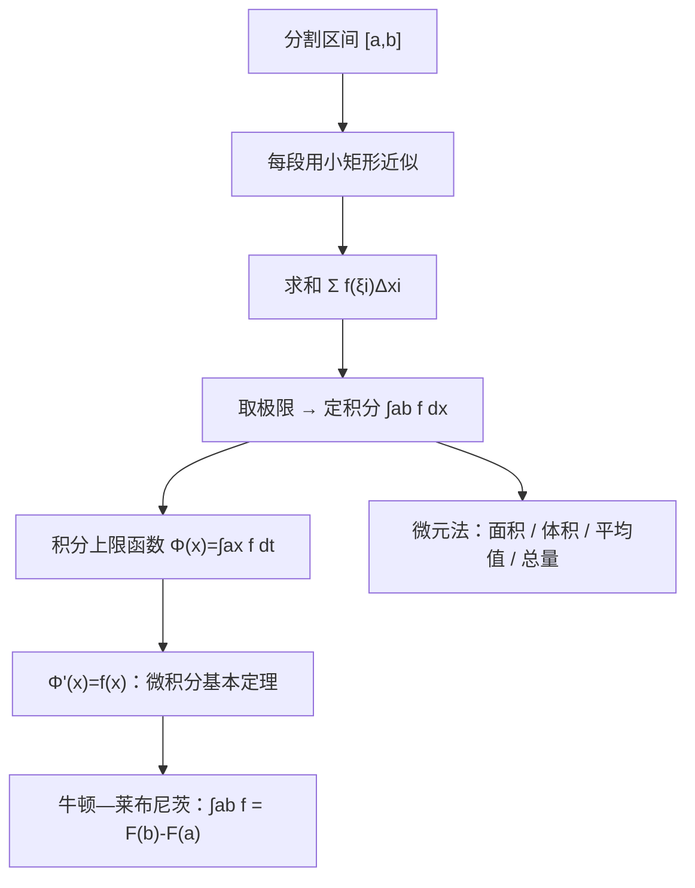

# 第 5 章：定积分及其应用

- **难度**：★★☆ | **预估学时**：9 小时 | **前置**：第 4 章（不定积分）、第 3 章（中值定理）

## 学习目标

学完本章，你能：

1. 说出定积分"分割—近似—求和—取极限"的构造，解释它和有向面积的关系；
2. 用牛顿—莱布尼茨公式算定积分，换元时正确改上下限，分部积分不漏项；
3. 判断反常积分收敛还是发散；
4. 用微元法算面积、旋转体体积、平均值，并把"速率对时间积分得总量"用到食品检测里。

## 一句话核心

定积分是把无数个"小矩形面积"加起来取极限；牛顿—莱布尼茨公式把这件事变成"求原函数、代端点、相减"。

## 零基础讲解

### 概念 1：定积分的定义（高难）

设 $f(x)$ 在 $[a,b]$ 上有界。把区间分成 $n$ 小段，分点 $a=x_0<x_1<\dots<x_n=b$，每段长 $\Delta x_i=x_i-x_{i-1}$。在第 $i$ 段里任取一点 $\xi_i$，用小矩形面积 $f(\xi_i)\Delta x_i$ 近似这一小条曲边梯形的面积。把所有小矩形加起来，再让最大段长趋于 0：

$$∫_a^b f(x)\,dx=\lim_{\max\Delta x_i\to 0}\sum_{i=1}^{n}f(\xi_i)\Delta x_i$$

这个极限存在，就说 $f$ 在 $[a,b]$ 上可积。连续函数一定可积，有有限个第一类间断点的有界函数也可积。

几何意义是**有向面积**：$x$ 轴上方的面积记正，下方的记负。所以 $\int_{-1}^{1}x\,dx=0$，左右两块面积相等、符号相反。

定积分的性质里最常用的四条：

$$∫_a^b[c_1f+c_2g]dx=c_1∫_a^bf\,dx+c_2∫_a^bg\,dx$$
$$∫_a^bf\,dx=∫_a^cf\,dx+∫_c^bf\,dx$$
$$f\ge0\Rightarrow∫_a^bf\,dx\ge0$$
$$∫_a^bf\,dx=f(\xi)(b-a),\quad \xi\in[a,b]$$

最后一条叫**积分中值定理**，它说明 $f(\xi)$ 就是区间上的平均值：

$$\bar f=\frac{1}{b-a}∫_a^bf(x)\,dx$$

### 概念 2：微积分基本定理（高难）

设 $f$ 连续，定义**积分上限函数**

$$\Phi(x)=∫_a^x f(t)\,dt$$

则 $\Phi'(x)=f(x)$。证明思路：$\Phi(x+\Delta x)-\Phi(x)=\int_x^{x+\Delta x}f(t)dt=f(\xi)\Delta x$，当 $\Delta x\to0$ 时 $\xi\to x$，$f(\xi)\to f(x)$。

这条定理是整个微积分的枢纽：求导与求积分互为逆运算。

由此得到**牛顿—莱布尼茨公式**：若 $F$ 是 $f$ 的任一原函数，

$$∫_a^bf(x)\,dx=F(b)-F(a)$$

例：$\int_1^2(3x^2+1)dx=\left[x^3+x\right]_1^2=(8+2)-(1+1)=8$。

例：$\int_0^1x^2dx=\left[\frac{x^3}{3}\right]_0^1=\frac{1}{3}$。

### 概念 3：定积分的换元与分部（进阶）

**换元**要同时换被积式、$dx$ 和上下限。若 $x=\varphi(t)$，$x=a$ 对应 $t=\alpha$，$x=b$ 对应 $t=\beta$：

$$∫_a^bf(x)dx=∫_\alpha^\beta f(\varphi(t))\varphi'(t)\,dt$$

例：$\int_0^{\pi/2}\sin x\cos x\,dx$。令 $u=\sin x$，$x=0\to u=0$，$x=\pi/2\to u=1$：

$$∫_0^1u\,du=\frac{1}{2}$$

**分部积分**：

$$∫_a^bu\,dv=[uv]_a^b-∫_a^bv\,du$$

例：$\int_0^1xe^xdx=[xe^x]_0^1-\int_0^1e^xdx=e-(e-1)=1$。

### 概念 4：反常积分（进阶）

积分区间无限，或被积函数在端点无界，叫**反常积分**。

两类基本模型：

$$∫_1^\infty\frac{dx}{x^p}\ \text{当}\ p>1\ \text{收敛，}p\le1\ \text{发散}$$
$$∫_0^1\frac{dx}{x^p}\ \text{当}\ p<1\ \text{收敛，}p\ge1\ \text{发散}$$

例：$\int_1^\infty\frac{dx}{x^2}=1$；$\int_0^\infty e^{-kt}dt=\frac{1}{k}$（$k>0$）。

计算方法仍然是"先算有限区间，再取极限"：$\int_a^\infty f=\lim_{b\to\infty}\int_a^bf$。

### 概念 5：微元法（进阶）

把总量切成无数小份，每份近似等于"某个密度乘以小长度"，再积分。四步：

1. 选积分变量 $x$，确定范围 $[a,b]$；
2. 在 $[x,x+dx]$ 上取一小块，写出微元 $dA$；
3. 把微元积分 $A=\int_a^bdA$；
4. 检查量纲与符号是否合理。

常用公式：

| 量 | 公式 |
|---|---|
| 曲线 $y=f(x)$ 下的面积 | $A=\int_a^bf(x)dx$ |
| 两曲线之间的面积 | $A=\int_a^b\lvert f-g\rvert dx$ |
| 绕 $x$ 轴旋转体体积 | $V=\pi\int_a^bf^2(x)dx$ |
| 平行截面面积已知的立体体积 | $V=\int_a^bA(x)dx$ |
| 平面曲线弧长 | $L=\int_a^b\sqrt{1+(f')^2}dx$ |
| 函数平均值 | $\bar f=\frac{1}{b-a}\int_a^bf(x)dx$ |

例：$y=x$ 与 $y=x^2$ 在 $[0,1]$ 之间围成的面积：

$$A=∫_0^1(x-x^2)dx=\frac{1}{2}-\frac{1}{3}=\frac{1}{6}$$

例：$y=\sqrt{x}$ 在 $[0,1]$ 上绕 $x$ 轴旋转的体积：

$$V=π∫_0^1x\,dx=\frac{π}{2}$$

## 图示

看图说明：上面一条链是"定义怎么来"，下面接到"怎么算"。定义给出意义，上限函数给出求导关系，N-L 公式把它变成代端点相减，微元法把积分用到几何和物理量上。

## 类比与实例

类比：定积分像用方格纸量不规则湖面的面积。格子越小，数得越准；取极限就是格子无限小。失效边界：湖泊边界可以无限细分，但实际测量总有分辨率，所以工程上只能算到某个精度（第 10 章的数值积分）。

实例（食品）：某批果汁中维生素 C 的降解速率 $r(t)=1.8e^{-0.015t}$ mg/(100mL·天)，求前 30 天总共损失多少。

$$ΔC=∫_0^{30}1.8e^{-0.015t}dt=1.8\left[\frac{e^{-0.015t}}{-0.015}\right]_0^{30}=\frac{1.8}{0.015}\left(1-e^{-0.45}\right)$$

$$=120\times(1-0.6376)=43.5\ \text{mg/100mL}$$

如果初始含量 120 mg/100mL，30 天后剩 76.5 mg/100mL，和这个损失量对得上（120−43.5=76.5）。速率积分与浓度差互为验算。

## 常见误解

- 别把定积分当成"面积"，它是有向面积，函数在 $x$ 轴下方时积分值为负。
- 别忘记换元时改上下限——换了变量却还用原来的 $0$ 到 $1$，答案必错。
- 别以为反常积分一定发散——$\int_1^\infty x^{-2}dx$ 收敛到 1，虽然区间无限长，但尾巴衰减得够快。
- 别在 N-L 公式里漏掉负号或代反端点——$F(b)-F(a)$，不是 $F(a)-F(b)$。

## 自测题（答案）

1. 单选：$\int_0^1x^2dx$ 等于（ ）（答案：A；解析：$x^3/3$ 在 0 到 1 上取值差）
   - A. $\frac{1}{3}$　B. $\frac{1}{2}$　C. 1　D. $\frac{1}{4}$

2. 单选：下列反常积分收敛的是（ ）（答案：B；解析：$p=2>1$ 收敛）
   - A. $\int_1^\infty\frac{dx}{x}$　B. $\int_1^\infty\frac{dx}{x^2}$　C. $\int_0^1\frac{dx}{x}$　D. $\int_1^\infty x\,dx$

3. 填空：$\int_0^1(x-x^2)dx=$ ____（答案：$\frac{1}{6}$）

4. 计算：某反应速率 $r(t)=6t$ kg/h，求前 4 小时的总产量，并说明与 $M(t)=3t^2$ 的关系。（答案：$\int_0^4 6t\,dt=[3t^2]_0^4=48$ kg；$M(t)$ 是原函数，$M(4)-M(0)=48$）

5. 计算：求 $y=\sqrt{x}$ 在 $[0,1]$ 绕 $x$ 轴旋转的体积。（答案：$\frac{\pi}{2}$）

## 复习锚点

- 定积分 = 分割求和取极限；几何上是有向面积。
- 微积分基本定理：先求原函数，再代上下限相减。
- 微元法四步：选变量、写微元、积分、验量纲。
