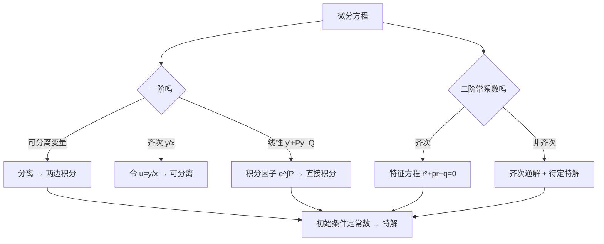

# 第 6 章：微分方程

- **难度**：★★★ | **预估学时**：10 小时 | **前置**：第 5 章（定积分）、第 2 章（导数）

## 学习目标

学完本章，你能：

1. 判断微分方程的阶，区分通解与特解，用初始条件定常数；
2. 解可分离变量方程、齐次方程、一阶线性方程；
3. 解二阶常系数线性齐次方程，写出非齐次方程的特解形式；
4. 把牛顿冷却、微生物生长、营养物降解建成微分方程并算出结果。

## 一句话核心

微分方程是"含未知函数及其导数的方程"；解它的过程，就是从一个变化规律反推整个过程的形状。

## 零基础讲解

### 概念 1：基本概念（基础）

含未知函数 $y$ 及其导数的方程叫**微分方程**。方程里出现的最高阶导数的阶数叫**阶**。$y'+2y=0$ 是一阶，$y''+y=0$ 是二阶。

不含任意常数的解叫**特解**；含与阶数相同个数的任意常数的解叫**通解**。二阶方程的通解含两个常数，一阶含一个。

**初始条件**用来定常数。$y'=2x$ 的通解是 $y=x^2+C$；若已知 $y(0)=3$，则 $C=3$，特解 $y=x^2+3$。

### 概念 2：可分离变量方程（基础）

形如

$$\frac{dy}{dx}=f(x)g(y)$$

的做法是把 $y$ 和 $x$ 分到两边：

$$\frac{dy}{g(y)}=f(x)dx\ \Longrightarrow\ ∫\frac{dy}{g(y)}=∫f(x)dx$$

例：$\frac{dy}{dx}=2xy$，$y(0)=1$。

$$\frac{dy}{y}=2x\,dx\ \Longrightarrow\ \ln|y|=x^2+C\ \Longrightarrow\ y=Ce^{x^2}$$

代入 $y(0)=1$ 得 $C=1$，所以 $y=e^{x^2}$。

**牛顿冷却定律**是最典型的可分离变量模型：物体温度 $T$ 与环境温度 $T_m$ 的差，降温速率与这个差成正比。

$$\frac{dT}{dt}=-k(T-T_m)$$

分离变量并积分：

$$\ln|T-T_m|=-kt+C\ \Longrightarrow\ T=T_m+Ce^{-kt}$$

例：一杯 90 ℃ 的牛奶放在 20 ℃ 房间，10 min 后降到 60 ℃。求 $k$ 与 $T(t)$。

$T(0)=90$：$C=70$。$T(10)=60$：$70e^{-10k}=40$，$e^{-10k}=\frac{4}{7}$，$k=\frac{1}{10}\ln\frac{7}{4}\approx0.056$ /min。

$$T(t)=20+70e^{-0.056t}$$

第 30 分钟：$T=20+70e^{-1.68}=20+70\times0.186=33.0$ ℃。

### 概念 3：齐次方程（进阶）

形如 $\frac{dy}{dx}=\varphi\left(\frac{y}{x}\right)$ 的方程，令 $u=\frac{y}{x}$，则 $y=ux$，$\frac{dy}{dx}=u+x\frac{du}{dx}$，代回就变成可分离变量。

例：$\frac{dy}{dx}=\frac{x+y}{x}=1+\frac{y}{x}$。令 $u=y/x$：

$$u+xu'=1+u\ \Longrightarrow\ xu'=1\ \Longrightarrow\ u=\ln|x|+C$$

$$y=x(\ln|x|+C)$$

### 概念 4：一阶线性方程（高难）

标准形：

$$\frac{dy}{dx}+P(x)y=Q(x)$$

通解公式：

$$y=e^{-∫P(x)dx}\left[∫Q(x)e^{∫P(x)dx}dx+C\right]$$

不用死记，理解成"先乘一个积分因子 $\mu=e^{\int P dx}$，让左边变成 $(y\mu)'$"。两边乘 $\mu$ 后：

$$\mu y'+\mu Py=(y\mu)'=\mu Q$$

再积分：$y\mu=\int\mu Q\,dx+C$，除回去就是上面的公式。第 22 号概念页有完整推导。

例：$y'+2y=4$，$y(0)=0$。$P=2$，$Q=4$，$\mu=e^{2x}$：

$$(ye^{2x})'=4e^{2x}\ \Longrightarrow\ ye^{2x}=2e^{2x}+C\ \Longrightarrow\ y=2+Ce^{-2x}$$

代入 $y(0)=0$：$2+C=0$，$C=-2$，$y=2(1-e^{-2x})$。这条曲线从 0 起，单调升向 2，是典型的"趋近稳态"过程。

### 概念 5：二阶常系数线性齐次方程（高难）

$$y''+py'+qy=0$$

猜 $y=e^{rx}$，代进去得 $e^{rx}(r^2+pr+q)=0$，所以 $r$ 满足**特征方程**

$$r^2+pr+q=0$$

三种情况：

| 判别式 | 特征根 | 通解 |
|---|---|---|
| $p^2-4q>0$ | 两个不等实根 $r_1,r_2$ | $y=C_1e^{r_1x}+C_2e^{r_2x}$ |
| $p^2-4q=0$ | 重根 $r$ | $y=(C_1+C_2x)e^{rx}$ |
| $p^2-4q<0$ | 共轭复根 $\alpha\pm\beta i$ | $y=e^{\alpha x}(C_1\cos\beta x+C_2\sin\beta x)$ |

例：$y''-5y'+6y=0$。特征方程 $r^2-5r+6=0$，$r=2,3$，通解 $y=C_1e^{2x}+C_2e^{3x}$。

例：$y''+4y=0$。$r^2+4=0$，$r=\pm2i$，通解 $y=C_1\cos2x+C_2\sin2x$。

例：$y''-2y'+y=0$。$(r-1)^2=0$，重根 $r=1$，通解 $y=(C_1+C_2x)e^x$。

重根为什么要多乘一个 $x$？因为 $e^{x}$ 和 $xe^{x}$ 都满足方程，而两个线性无关的解才能凑出通解。

### 概念 6：二阶常系数非齐次方程（进阶）

$$y''+py'+qy=f(x)$$

通解 = 对应齐次方程的通解 $Y$ + 一个特解 $y^*$。

$f(x)$ 是多项式、指数、正弦余弦时，用**待定系数法**：

- $f(x)=P_n(x)$，设 $y^*=x^kQ_n(x)$，$k$ 是 0 在原特征方程里作根的重数。
- $f(x)=e^{\lambda x}P_n(x)$，设 $y^*=x^kQ_n(x)e^{\lambda x}$。
- $f(x)=e^{\alpha x}[A\cos\beta x+B\sin\beta x]$，设 $y^*=x^ke^{\alpha x}[C\cos\beta x+D\sin\beta x]$。

例：$y''+y=1$。齐次通解 $C_1\cos x+C_2\sin x$；右端是常数，$0$ 不是特征根，设 $y^*=A$，代入得 $A=1$。通解 $y=1+C_1\cos x+C_2\sin x$。

### 概念 7：可降阶的方程（了解）

- $y''=f(x)$：连续积两次。
- $y''=f(x,y')$：令 $p=y'$，则 $y''=p'$，变成一阶方程。
- $y''=f(y,y')$：令 $p=y'$，$y''=p\frac{dp}{dy}$，把 $y$ 当自变量。

### 概念 8：增长模型（进阶）

**指数增长**：$N'=rN$，解 $N=N_0e^{rt}$。细菌在对数期、营养充足时符合。

**逻辑斯蒂增长**：环境有承载上限 $K$，增长先快后慢：

$$\frac{dN}{dt}=rN\left(1-\frac{N}{K}\right)$$

分离变量积分得

$$N(t)=\frac{K}{1+\left(\frac{K}{N_0}-1\right)e^{-rt}}$$

例：发酵罐承载上限 $K=1000$（以浊度计），初始 50，$r=0.4$/h：

$$N(t)=\frac{1000}{1+19e^{-0.4t}}$$

$t=10$：$e^{-4}=0.0183$，分母 $1+0.348=1.348$，$N\approx742$。$t\to\infty$ 时 $N\to1000$，不会无限涨。

## 图示

看图说明：左边一阶分三条路——可分离、齐次（换元后可分离）、线性（积分因子）。右边二阶先看齐次与否；齐次解特征方程，非齐次在齐次通解上加特解。所有路径最后都用初始条件定常数。

## 类比与实例

类比：微分方程像给了一段"每天长多少"的规则，让你还原整棵生长曲线。规则只描述瞬时变化，曲线形状是解出来的。失效边界：真实种群的"规则"会随环境变，方程里的 $r$、$K$ 是近似常数，环境突变时模型要重写。

实例（食品）：某果酱的香气成分按一级反应降解，$C'=-0.02C$，初始 $C_0=80$ mg/kg。求 $C(t)$ 与半衰期。

$$C=80e^{-0.02t}$$

半衰期是降到一半所需时间：$80e^{-0.02t}=40$，$t=\ln2/0.02\approx34.7$ 天。这类"半衰期"在食品货架期预测里很常用。

## 常见误解

- 别把通解当成唯一答案——一阶方程的通解含一个常数，初始条件不同，特解就不同。
- 别在分离变量时丢掉 $y=0$ 这类常数解——除以 $y$ 时若 $y=0$ 也是解，要单独说明。
- 别把特征根算错——$r^2+pr+q=0$ 的根是 $\frac{-p\pm\sqrt{p^2-4q}}{2}$，符号最容易错。
- 别忘记非齐次方程的通解还要加齐次通解——只写特解是不完整的。

## 自测题（答案）

1. 单选：$y'=2xy$ 的通解是（ ）（答案：C；解析：分离变量积分得 $\ln|y|=x^2+C$）
   - A. $y=2x+C$　B. $y=Ce^{2x}$　C. $y=Ce^{x^2}$　D. $y=x^2+C$

2. 单选：$y''-5y'+6y=0$ 的通解是（ ）（答案：B；解析：特征根 2、3）
   - A. $y=C_1e^{-2x}+C_2e^{-3x}$　B. $y=C_1e^{2x}+C_2e^{3x}$　C. $y=(C_1+C_2x)e^{2x}$　D. $y=C_1\cos2x+C_2\sin3x$

3. 填空：$y'+2y=0$，$y(0)=5$ 的特解是 ____（答案：$y=5e^{-2x}$）

4. 计算：90 ℃ 牛奶在 20 ℃ 房间冷却，10 min 后 60 ℃，求 30 min 后的温度。（答案：$k\approx0.056$，$T=20+70e^{-1.68}\approx33.0$ ℃）

5. 计算：$y''+4y=0$ 的通解。（答案：$y=C_1\cos2x+C_2\sin2x$）

## 复习锚点

- 一阶：可分离直接分，齐次令 $u=y/x$，线性用积分因子。
- 二阶常系数：先写特征方程，再看判别式三种情况。
- 非齐次通解 = 齐次通解 + 特解；初始条件定常数。
