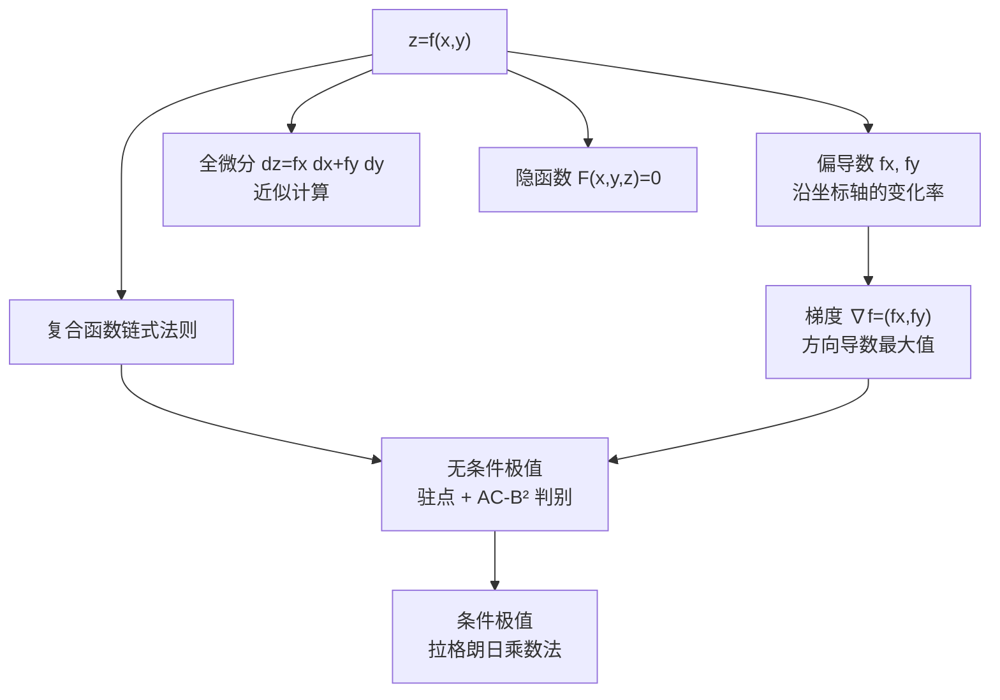

# 第 7 章：多元函数微分学

- **难度**：★★★ | **预估学时**：9 小时 | **前置**：第 3 章（导数应用）

## 学习目标

学完本章，你能：

1. 写出二元函数的定义域，认出球面、柱面、旋转抛物面这类常见曲面；
2. 求偏导数与全微分，用它们做近似计算；
3. 用链式法则求多元复合函数与隐函数的偏导；
4. 求无条件极值，用拉格朗日乘数法解带约束的配方优化问题。

## 一句话核心

多元函数里，"变化"有了方向：偏导数是沿坐标轴方向的瞬时变化率，全微分是所有方向变化的线性汇总。

## 零基础讲解

### 概念 1：空间解析几何与二元函数（基础）

空间直角坐标系用三个互相垂直的轴 $(x,y,z)$ 定位。两点距离

$$d=\sqrt{(x_2-x_1)^2+(y_2-y_1)^2+(z_2-z_1)^2}$$

常见曲面：

- 球面 $(x-a)^2+(y-b)^2+(z-c)^2=R^2$；
- 圆柱面 $x^2+y^2=R^2$（缺少 $z$，沿 $z$ 方向无限延伸）；
- 旋转抛物面 $z=x^2+y^2$（碗形）；
- 平面 $Ax+By+Cz+D=0$。

二元函数 $z=f(x,y)$ 的定义域是 $xy$ 平面上的一个区域。$z=\ln(x+y)$ 要求 $x+y>0$；$z=\sqrt{1-x^2-y^2}$ 要求 $x^2+y^2\le1$，是个圆盘。

### 概念 2：偏导数（进阶）

求 $\frac{\partial z}{\partial x}$ 时，把 $y$ 当常数，只对 $x$ 求导；求 $\frac{\partial z}{\partial y}$ 时反过来。

例：$z=x^2y+\sin(xy)$。

$$\frac{\partial z}{\partial x}=2xy+y\cos(xy),\qquad \frac{\partial z}{\partial y}=x^2+x\cos(xy)$$

几何意义：曲面被平面 $y=y_0$ 截出一条曲线，$\frac{\partial z}{\partial x}$ 是这条曲线在 $x$ 方向的切线斜率。

二阶偏导有四个：$z_{xx}$、$z_{xy}$、$z_{yx}$、$z_{yy}$。当它们连续时，$z_{xy}=z_{yx}$，混合偏导与求导次序无关。

### 概念 3：全微分（进阶）

$$\Delta z\approx dz=\frac{\partial z}{\partial x}dx+\frac{\partial z}{\partial y}dy$$

可微的充分条件是偏导数连续。近似公式：

$$f(x_0+\Delta x,y_0+\Delta y)\approx f(x_0,y_0)+f_x\Delta x+f_y\Delta y$$

例：$z=x^2y$，在 $(2,3)$ 处 $\Delta x=0.01$，$\Delta y=-0.02$。$f_x=2xy=12$，$f_y=x^2=4$：

$$dz=12\times0.01+4\times(-0.02)=0.12-0.08=0.04$$

原值 $f(2,3)=12$，近似新值 $12.04$。直接算 $2.01^2\times2.98=4.0401\times2.98=12.0395$，误差 0.0005。

### 概念 4：多元复合函数求导（进阶）

链式法则画成树：$z=f(u,v)$，$u=u(x,y)$，$v=v(x,y)$：

$$\frac{\partial z}{\partial x}=\frac{\partial z}{\partial u}\frac{\partial u}{\partial x}+\frac{\partial z}{\partial v}\frac{\partial v}{\partial x}$$

$$\frac{\partial z}{\partial y}=\frac{\partial z}{\partial u}\frac{\partial u}{\partial y}+\frac{\partial z}{\partial v}\frac{\partial v}{\partial y}$$

口诀：每条路径上的偏导相乘，不同路径相加。

例：$z=u^2+v^2$，$u=x+y$，$v=x-y$。$z_x=2u\cdot1+2v\cdot1=4x$，$z_y=2u\cdot1+2v\cdot(-1)=4y$。

**隐函数**：$F(x,y,z)=0$ 确定 $z=z(x,y)$，则

$$\frac{\partial z}{\partial x}=-\frac{F_x}{F_z},\qquad \frac{\partial z}{\partial y}=-\frac{F_y}{F_z}$$

例：$x^2+y^2+z^2=3$ 在 $(1,1,1)$ 处。$F_x=2x=2$，$F_z=2z=2$，$z_x=-1$。

### 概念 5：梯度与方向导数（进阶）

**梯度**是偏导数组成的向量：

$$\nabla f=\left(\frac{\partial f}{\partial x},\frac{\partial f}{\partial y}\right)$$

沿单位方向 $\mathbf{u}=(\cos\alpha,\cos\beta)$ 的**方向导数**

$$\frac{\partial f}{\partial \mathbf{u}}=\nabla f\cdot\mathbf{u}=f_x\cos\alpha+f_y\cos\beta$$

梯度的两个结论：方向导数在梯度方向取最大值，最大值等于 $|\nabla f|$；梯度方向是函数增长最快的方向，反方向下降最快。

例：$f=x^2+y^2$ 在 $(1,2)$ 处，$\nabla f=(2,4)$。最大方向导数 $\sqrt{2^2+4^2}=\sqrt{20}\approx4.47$。

食品里的用法：干燥工艺参数（温度、风速）构成二维平面，梯度指出"往哪个方向调参数，干燥速率提升最快"。

### 概念 6：无条件极值（进阶）

驻点满足 $f_x=0$，$f_y=0$。判别用二阶偏导：

$$A=f_{xx},\quad B=f_{xy},\quad C=f_{yy},\quad \Delta=AC-B^2$$

- $\Delta>0$ 且 $A<0$：极大值；
- $\Delta>0$ 且 $A>0$：极小值；
- $\Delta<0$：不是极值（鞍点）；
- $\Delta=0$：判别失效，另想办法。

例：$z=x^2+y^2-2x-4y$。$z_x=2x-2=0\Rightarrow x=1$；$z_y=2y-4=0\Rightarrow y=2$。$A=2,B=0,C=2$，$\Delta=4>0,A>0$，极小值 $z(1,2)=1+4-2-8=-5$。

### 概念 7：条件极值与拉格朗日乘数法（高难）

求 $z=f(x,y)$ 在约束 $g(x,y)=0$ 下的极值，构造

$$L(x,y,\lambda)=f(x,y)+\lambda g(x,y)$$

解方程组：

$$L_x=f_x+\lambda g_x=0,\quad L_y=f_y+\lambda g_y=0,\quad L_\lambda=g(x,y)=0$$

几何道理：极值点处目标函数的等值线与约束曲线相切，两曲线的法向量（梯度）平行，所以 $\nabla f=\lambda\nabla g$。

例：周长 20 cm 的矩形，求最大面积。约束 $2x+2y=20$，目标 $S=xy$。

$$L=xy+\lambda(2x+2y-20)$$

$$L_x=y+2\lambda=0,\quad L_y=x+2\lambda=0\Rightarrow x=y$$

代回约束：$4x=20$，$x=y=5$，面积 25 cm²。正方形是周长固定时面积最大的矩形。

## 图示

看图说明：左边偏导数先拆出两个方向的变化率，全微分再把它们合成线性近似；偏导数组成梯度，梯度接到极值判别；最后在约束条件下用拉格朗日乘数法，把"梯度平行"变成方程。

## 类比与实例

类比：偏导数像在山上只沿东西方向走时的坡度，换南北方向又是另一个坡度；梯度像指南针，指向最陡的上坡方向。失效边界：山不一定光滑，真实地形可能有多处山峰（局部极值），梯度只给局部信息。

实例（食品配方）：两种原料 A、B，蛋白质含量分别为 20% 与 40%，成本 8 元/kg 与 15 元/kg。要配 100 kg 产品，蛋白含量不低于 32%，求最低成本。

设 A 用 $x$ kg，B 用 $y$ kg。约束 $x+y=100$，$0.2x+0.4y\ge32$，即 $y\ge60$。成本 $C=8x+15y=8(100-y)+15y=800+7y$。$y$ 越小成本越低，取 $y=60$，$x=40$，成本 $800+420=1220$ 元。这是线性约束下的边界最优，和第 3 章"约束起作用时最优解在边界"是同一回事。

## 常见误解

- 别把偏导数当成"把另一个变量当 0"——是当常数，不是当 0。$z=x^2y$ 对 $x$ 求偏导得 $2xy$，不是 $2x$。
- 别以为 $f_x$、$f_y$ 都存在就一定可微——偏导存在只是必要条件，还要偏导连续。
- 别把梯度当成一个数——它是向量，有方向。
- 别以为拉格朗日乘数法只给最大值——它给的是所有可能的极值点，还要比较函数值。

## 自测题（答案）

1. 单选：$z=x^2y+\sin(xy)$ 的 $\dfrac{\partial z}{\partial x}$ 是（ ）（答案：C；解析：对 $x$ 求偏导，$y$ 当常数）
   - A. $x^2+y\cos(xy)$　B. $2xy+x\cos(xy)$　C. $2xy+y\cos(xy)$　D. $2xy+\cos(xy)$

2. 单选：$z=x^2+y^2-2x-4y$ 的极小值点是（ ）（答案：B；解析：驻点 $(1,2)$，$A>0,\Delta>0$）
   - A. $(0,0)$　B. $(1,2)$　C. $(2,4)$　D. $(-1,-2)$

3. 填空：$f=x^2+y^2$ 在 $(1,2)$ 处梯度的模为 ____（答案：$\sqrt{20}\approx4.47$）

4. 计算：$x^2+y^2+z^2=3$ 在 $(1,1,1)$ 处的 $\dfrac{\partial z}{\partial x}$。（答案：$-1$）

5. 计算：周长 20 cm 的矩形最大面积。（答案：正方形，边长 5 cm，面积 25 cm²）

## 复习锚点

- 偏导：对谁求导，另一个当常数；全微分 = 偏导乘以对应增量再相加。
- 梯度指向增长最快的方向，方向导数在梯度方向取最大值 $|\nabla f|$。
- 条件极值：构造 $L=f+\lambda g$，解偏导为 0 的方程组。
