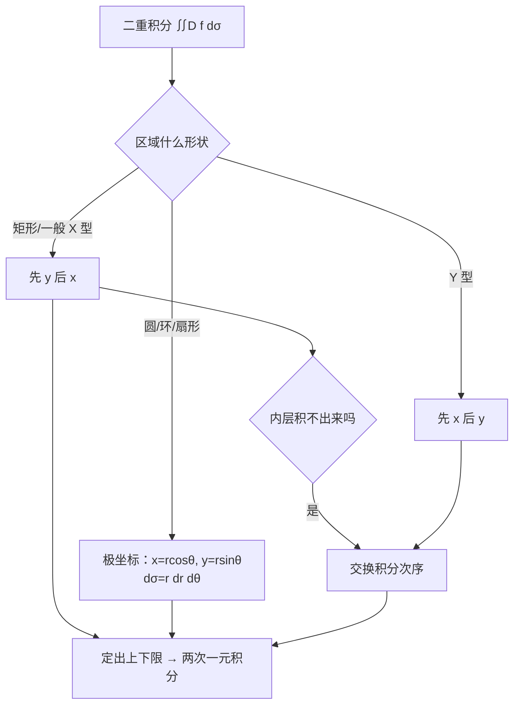

# 第 8 章：二重积分

- **难度**：★★★ | **预估学时**：7 小时 | **前置**：第 7 章（多元函数）、第 5 章（定积分）

## 学习目标

学完本章，你能：

1. 说出二重积分"分割—近似—求和—取极限"的构造与几何意义；
2. 在直角坐标下把二重积分化成两次定积分，画出积分区域并正确确定上下限；
3. 交换积分次序，把难算的内层积分变简单；
4. 用极坐标算圆域上的积分，并用二重积分求质量、重心、平均温度。

## 一句话核心

二重积分是把平面区域切成小面片，用"高度 × 面积"求和取极限；算的时候降维成两次一元积分。

## 零基础讲解

### 概念 1：二重积分的定义与几何意义（进阶）

设 $f(x,y)$ 在有界闭区域 $D$ 上有界。把 $D$ 分成 $n$ 个小面片，第 $i$ 片面积 $\Delta\sigma_i$，在其中任取一点 $(\xi_i,\eta_i)$，作和 $\sum f(\xi_i,\eta_i)\Delta\sigma_i$，让最大直径趋于 0：

$$\iint_D f(x,y)\,d\sigma=\lim_{\max d_i\to0}\sum_{i=1}^n f(\xi_i,\eta_i)\Delta\sigma_i$$

几何意义：$f\ge0$ 时，它是曲面 $z=f(x,y)$ 在 $D$ 上顶着的**曲顶柱体体积**。

物理意义更实用：若 $\rho(x,y)$ 是面密度（kg/m²），则

$$m=\iint_D\rho(x,y)\,d\sigma$$

就是薄片的总质量。同理，$\iint_D T(x,y)d\sigma$ 除以面积得平均温度。

### 概念 2：直角坐标下的计算（进阶）

把 $D$ 投影到 $x$ 轴，若区域是 **X 型**（$a\le x\le b$，$y_1(x)\le y\le y_2(x)$）：

$$\iint_D f\,d\sigma=\int_a^b dx\int_{y_1(x)}^{y_2(x)}f(x,y)\,dy$$

若是 **Y 型**（$c\le y\le d$，$x_1(y)\le x\le x_2(y)$）：

$$\iint_D f\,d\sigma=\int_c^d dy\int_{x_1(y)}^{x_2(y)}f(x,y)\,dx$$

内层积分把另一个变量当常数，外层再积。上下限的顺序不能反。

例：$D:\ 0\le x\le1,\ 0\le y\le2$，算 $\iint_D(x+y)d\sigma$：

$$∫_0^1dx∫_0^2(x+y)dy=∫_0^1\left[xy+\frac{y^2}{2}\right]_0^2dx=∫_0^1(2x+2)dx=\left[x^2+2x\right]_0^1=3$$

### 概念 3：交换积分次序（高难）

有的内层积分积不出来，换序后能积。做法是画出积分区域，按另一个方向重新写上下限。

例：$\int_0^1dx\int_x^1e^{-y^2}dy$。内层对 $y$ 积 $e^{-y^2}$ 没有初等原函数，必须换序。

区域：$0\le x\le1$，$x\le y\le1$，是三角形。换成先 $x$ 后 $y$：$0\le y\le1$，$0\le x\le y$。

$$∫_0^1dy∫_0^ye^{-y^2}dx=∫_0^1ye^{-y^2}dy=\left[-\frac{1}{2}e^{-y^2}\right]_0^1=\frac{1}{2}(1-e^{-1})\approx0.316$$

换序的价值在于：内层多出来的 $x$ 积分给出了一个因子 $y$，正好和 $e^{-y^2}$ 凑成微分。

### 概念 4：极坐标（进阶）

圆域、圆环、扇形区域用极坐标。令

$$x=r\cos\theta,\quad y=r\sin\theta,\quad d\sigma=r\,dr\,d\theta$$

注意面积元多一个 $r$，漏掉它结果必错。

$$x^2+y^2=r^2$$

例：$D$ 是单位圆盘 $x^2+y^2\le1$，算 $\iint_D e^{-(x^2+y^2)}d\sigma$：

$$∫_0^{2\pi}d\theta∫_0^1e^{-r^2}r\,dr=2\pi\left[-\frac{1}{2}e^{-r^2}\right]_0^1=\pi(1-e^{-1})\approx1.986$$

例：$D$ 是圆环 $1\le x^2+y^2\le4$，$\iint_D1\,d\sigma$ 就是面积 $\pi(4-1)=3\pi$。

### 概念 5：对称性的简化（进阶）

- 区域关于 $y$ 轴对称：$f(-x,y)=-f(x,y)$ 时积分为 0；$f$ 是 $x$ 的偶函数时，等于 $2\iint_{D_{右}}f$。
- 区域关于 $x$ 轴对称：同理看 $y$ 的奇偶性。
- 区域关于原点对称：$f(-x,-y)=-f(x,y)$ 时积分为 0。

例：$D$ 是单位圆盘，$\iint_D x\,d\sigma=0$，因为 $x$ 是奇函数、区域对称。

## 图示

看图说明：先判区域形状选坐标系；X 型先对 $y$ 积，Y 型先对 $x$ 积，圆域转极坐标。内层积不动时回到换序这条边。所有路径最后都落到"两次一元积分"。

## 类比与实例

类比：二重积分像给一块不规则钢板称重。把钢板划成小方格，每格用"面密度 × 面积"估算重量，格子越小越准。失效边界：方格法在边界处有误差，实际计算靠数值积分（第 10 章）。

实例（食品）：圆形烤盘半径 20 cm，盘内物料的面密度随半径变化 $\rho(r)=2+0.01r^2$ kg/m²（边缘受热多、更干）。求总质量。

极坐标，$r$ 从 0 到 0.2 m，$\theta$ 从 0 到 $2\pi$：

$$m=∫_0^{2\pi}d\theta∫_0^{0.2}(2+0.01r^2)r\,dr=2\pi∫_0^{0.2}(2r+0.01r^3)dr$$

$$=2\pi\left[r^2+0.0025r^4\right]_0^{0.2}=2\pi(0.04+0.000004)\approx0.2513\ \text{kg}$$

约 251 g。若按平均密度 2.0004 kg/m² 乘面积 $\pi(0.2)^2=0.1257$ m²，得 0.2514 kg，两者一致，可作为验算。

## 常见误解

- 别漏掉极坐标的 $r$——$d\sigma=r\,dr\,d\theta$，不是 $dr\,d\theta$。
- 别把上下限写反——内层上限减下限，次序错了结果为负。
- 别在交换次序时重画错区域——先画出 $D$，再按新方向读边界。
- 别以为二重积分一定等于体积——$f$ 有正有负时是"代数和"，正负抵消。

## 自测题（答案）

1. 单选：$\iint_D(x+y)d\sigma$，$D:0\le x\le1,0\le y\le2$，等于（ ）（答案：C；解析：两次积分得 3）
   - A. 1　B. 2　C. 3　D. 4

2. 单选：极坐标下面积元是（ ）（答案：B；解析：雅可比行列式为 $r$）
   - A. $dr\,d\theta$　B. $r\,dr\,d\theta$　C. $r^2dr\,d\theta$　D. $drd\theta/r$

3. 填空：$\iint_D1\,d\sigma$，$D:x^2+y^2\le4$，等于 ____（答案：$4\pi$）

4. 计算：$\int_0^1dx\int_x^1e^{-y^2}dy$。（答案：$\frac{1}{2}(1-e^{-1})\approx0.316$；换序后先对 $x$ 积）

## 复习锚点

- 二重积分 = 曲顶柱体体积；算的时候降成两次一元积分。
- 极坐标别漏 $r$；圆域优先极坐标。
- 内层积不出来就画图换序。
