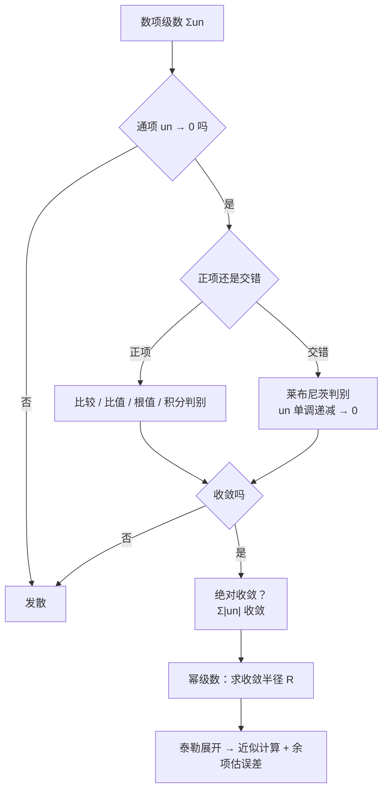

# 第 9 章：无穷级数

- **难度**：★★★ | **预估学时**：9 小时 | **前置**：第 2 章（高阶导数）、第 1 章（极限）

## 学习目标

学完本章，你能：

1. 判断几何级数、p 级数的敛散，说明"通项趋于 0"为什么不够；
2. 用比较、比值、根值、莱布尼茨四种判别法判断级数收敛；
3. 求幂级数的收敛半径与收敛区间，把函数展开成泰勒级数；
4. 用级数做近似计算并估计误差，理解食品检测中"近似到几位"的意义。

## 一句话核心

级数是无穷多个数相加；收敛的意思是部分和数列有极限。幂级数把函数写成无穷多项式，是近似计算的理论来源。

## 零基础讲解

### 概念 1：数项级数（基础）

把数列各项加起来：

$$\sum_{n=1}^{\infty}u_n=u_1+u_2+u_3+\cdots$$

前 $n$ 项和 $S_n=u_1+\cdots+u_n$ 叫**部分和**。若 $S_n$ 有极限 $S$，就说级数**收敛**，$S$ 是它的和；否则**发散**。

**几何级数**是最基本的一类：

$$\sum_{n=1}^{\infty}aq^{n-1}=\frac{a}{1-q}\quad(|q|<1)$$

$|q|\ge1$ 时发散。例：$\sum\frac{1}{2^n}=\frac{1/2}{1-1/2}=1$。

**p 级数**：

$$\sum_{n=1}^{\infty}\frac{1}{n^p}\ \text{当}\ p>1\ \text{收敛，}p\le1\ \text{发散}$$

$p=2$ 时和为 $\frac{\pi^2}{6}\approx1.6449$；$p=1$ 是调和级数，发散。

### 概念 2：收敛的必要条件（基础）

若 $\sum u_n$ 收敛，则 $u_n\to0$。逆命题不成立：调和级数 $\sum\frac{1}{n}$ 的通项趋于 0，级数却发散。

这条只能用来判**发散**：通项不趋于 0，级数一定发散。通项趋于 0 时还要进一步判别。

### 概念 3：正项级数的判别（进阶）

各项非负时，部分和单调递增，收敛等价于部分和有上界。

- **比较判别**：$0\le u_n\le v_n$，$\sum v_n$ 收敛则 $\sum u_n$ 收敛；$\sum u_n$ 发散则 $\sum v_n$ 发散。常拿 p 级数、几何级数当尺子。
- **极限比较**：$\lim\frac{u_n}{v_n}=c\ne0$，两级数同敛散。
- **比值判别**（达朗贝尔）：$\lim\frac{u_{n+1}}{u_n}=L$。$L<1$ 收敛，$L>1$ 发散，$L=1$ 失效。
- **根值判别**（柯西）：$\lim\sqrt[n]{u_n}=L$，判据同上。
- **积分判别**：$f$ 单调递减非负，$\sum f(n)$ 与 $\int_1^\infty f(x)dx$ 同敛散。

例：$\sum\frac{n!}{n^n}$。比值：

$$\frac{u_{n+1}}{u_n}=\frac{(n+1)!}{(n+1)^{n+1}}\cdot\frac{n^n}{n!}=\left(\frac{n}{n+1}\right)^n\to\frac{1}{e}<1$$

收敛。

例：$\sum\frac{1}{n^2+n}$。$\frac{1}{n^2+n}\sim\frac{1}{n^2}$，而 $\sum\frac{1}{n^2}$ 收敛，故收敛。

### 概念 4：交错级数与绝对收敛（进阶）

**莱布尼茨判别**：$u_n>0$，$u_n$ 单调递减，且 $u_n\to0$，则交错级数 $\sum(-1)^{n-1}u_n$ 收敛，且余项满足 $|R_n|\le u_{n+1}$。

例：$\sum(-1)^{n-1}\frac{1}{n}$ 收敛（和为 $\ln2$），但 $\sum\frac{1}{n}$ 发散，所以它是**条件收敛**。

若 $\sum|u_n|$ 收敛，则 $\sum u_n$ 一定收敛，叫**绝对收敛**。绝对收敛的级数可以任意重排，条件收敛不行——重排会改变和。

### 概念 5：幂级数（进阶）

形如

$$\sum_{n=0}^{\infty}a_n(x-x_0)^n$$

的级数。存在收敛半径 $R$，$|x-x_0|<R$ 时绝对收敛，$|x-x_0|>R$ 时发散，端点单独讨论。

$$R=\lim_{n\to\infty}\left|\frac{a_n}{a_{n+1}}\right|$$

例：$\sum\frac{x^n}{n}$。$R=\lim\frac{1/n}{1/(n+1)}=1$。$x=1$ 时是调和级数发散；$x=-1$ 时交错收敛。收敛区间 $[-1,1)$。

例：$\sum\frac{x^n}{n!}$。$R=\lim\frac{1/n!}{1/(n+1)!}=\lim(n+1)=\infty$，收敛区间 $(-\infty,\infty)$。

### 概念 6：泰勒级数（高难）

若 $f$ 在 $x_0$ 处任意阶可导，幂级数

$$f(x)=\sum_{n=0}^{\infty}\frac{f^{(n)}(x_0)}{n!}(x-x_0)^n$$

叫**泰勒级数**。$x_0=0$ 时叫麦克劳林级数。

必背五个展开：

$$e^x=1+x+\frac{x^2}{2!}+\frac{x^3}{3!}+\cdots,\quad |x|<\infty$$
$$\sin x=x-\frac{x^3}{3!}+\frac{x^5}{5!}-\cdots,\quad |x|<\infty$$
$$\cos x=1-\frac{x^2}{2!}+\frac{x^4}{4!}-\cdots,\quad |x|<\infty$$
$$\ln(1+x)=x-\frac{x^2}{2}+\frac{x^3}{3}-\cdots,\quad -1<x\le1$$
$$\frac{1}{1-x}=1+x+x^2+x^3+\cdots,\quad |x|<1$$

近似计算时用**拉格朗日余项**估误差：

$$R_n(x)=\frac{f^{(n+1)}(\xi)}{(n+1)!}x^{n+1},\quad \xi\text{ 在 }0\text{ 与 }x\text{ 之间}$$

例：算 $e^{0.1}$ 到小数点后 4 位。取前三项：

$$e^{0.1}\approx1+0.1+\frac{0.01}{2}=1.105$$

实际 $1.10517$。余项约 $\frac{e^{0.1}}{6}(0.1)^3\approx0.00018$，所以第三位小数才可靠。取四项加 $\frac{0.001}{6}=0.000167$ 得 $1.10517$，误差已在 $10^{-6}$ 量级。

### 概念 7：傅里叶级数（了解）

周期函数可以展开成三角函数的和：

$$f(x)=\frac{a_0}{2}+\sum_{n=1}^{\infty}(a_n\cos nx+b_n\sin nx)$$

系数由积分算出。方波的傅里叶级数只含奇次正弦项，这是信号处理、振动分析的起点。食品工程里用于分析周期性振动信号（如设备振动监测）。

## 图示

看图说明：先看必要条件筛掉一批；再按正项/交错选判别法；收敛后再看是绝对还是条件；右边把数项级数升级成幂级数，接到泰勒展开与近似计算。

## 类比与实例

类比：级数像往杯子里不断加水，每次加的量越来越小。收敛就是水最终停在一个固定高度，发散就是溢出或无限上涨。失效边界：数学上的"无限次"没有物理对应，实际计算只能取有限项，误差用余项估。

实例（食品）：一级反应 $C=C_0e^{-kt}$，在 $t$ 很小时估算浓度下降。用泰勒展开：

$$e^{-kt}=1-kt+\frac{(kt)^2}{2}-\cdots$$

若 $kt=0.05$，取前两项得 $C\approx C_0(1-0.05)=0.95C_0$；真实值 $e^{-0.05}=0.9512$，误差 0.0012，约 0.13%。货架期初期的快速估算可以用这个线性近似，$kt$ 超过 0.2 以后误差变大，就要多取项或直接算指数。

## 常见误解

- 别以为通项趋于 0 就收敛——调和级数是反例。
- 别把"条件收敛"当成"收敛得弱一点"——它不能随意重排，重排后和会变。
- 别忘记检查幂级数端点——收敛半径内的结论不覆盖端点。
- 别把泰勒展开的阶数当成越多越好——阶数高，计算量大，而且只在展开点附近准。

## 自测题（答案）

1. 单选：$\sum\dfrac{1}{n^2}$ 的敛散性是（ ）（答案：A；解析：p=2>1）
   - A. 收敛　B. 发散　C. 条件收敛　D. 无法判断

2. 单选：$\sum(-1)^{n-1}\dfrac{1}{n}$ 是（ ）（答案：C；解析：本身收敛，绝对值级数发散）
   - A. 绝对收敛　B. 发散　C. 条件收敛　D. 和为 1

3. 填空：$\sum\dfrac{x^n}{n!}$ 的收敛半径是 ____（答案：$+\infty$）

4. 计算：用泰勒展开算 $e^{0.1}$，取到 $x^3$ 项。（答案：$1+0.1+0.005+0.000167=1.105167$，误差约 $4\times10^{-6}$）

## 复习锚点

- 收敛的必要条件是通项趋于 0，但不充分。
- 正项级数看比值/根值 $L<1$ 收敛、$L>1$ 发散；交错看莱布尼茨。
- 幂级数先求 $R$，再单独查端点；泰勒展开记得估余项。
