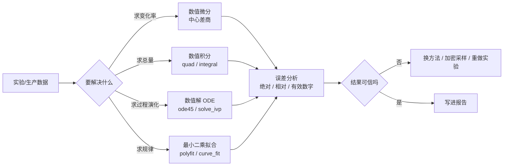

# 第 10 章：数学实验与误差分析

- **难度**：★★☆ | **预估学时**：8 小时 | **前置**：第 5 章（定积分）、第 6 章（微分方程）

## 学习目标

学完本章，你能：

1. 用 Python 或 MATLAB 完成数值微分、数值积分、常微分方程求解；
2. 用最小二乘拟合实验数据，判断拟合好坏；
3. 说清绝对误差、相对误差、有效数字的关系，正确记录和修约检测数据；
4. 独立完成"冷却曲线""发酵动力学""营养标签误差"三个小案例。

## 一句话核心

软件负责算，你负责建模、选方法和判断结果能不能用；误差分析是判断"能不能用"的唯一依据。

## 零基础讲解

### 概念 1：数值微分（进阶）

导数没有解析式，或解析式太复杂时，用差商近似：

$$f'(x)\approx\frac{f(x+h)-f(x)}{h}\quad\text{(向前差商)}$$

$$f'(x)\approx\frac{f(x+h)-f(x-h)}{2h}\quad\text{(中心差商)}$$

向前差商的误差是 $O(h)$，中心差商是 $O(h^2)$。但 $h$ 不能太小：$h$ 小到 $10^{-12}$ 时，浮点数相减会损失有效位，误差反而变大。实际取 $h\approx10^{-5}$ 到 $10^{-6}$ 比较稳。

### 概念 2：数值积分（进阶）

函数积不出来时，用求积公式：

- **梯形公式**：把区间分成 $n$ 段，每段用梯形面积近似，误差 $O(h^2)$。
- **辛普森公式**：每段用抛物线近似，误差 $O(h^4)$，同样分段数精度更高。

MATLAB 用 `integral`，Python 用 `scipy.integrate.quad`，它们会自动选步长并给出误差估计。

```python
from scipy.integrate import quad
import numpy as np

Q, err = quad(lambda t: 1.8 * np.exp(-0.015 * t), 0, 30)
print(f"30 天损失 {Q:.1f} mg/100mL，误差估计 {err:.2e}")
```

```matlab
f = @(t) 1.8*exp(-0.015*t);
[Q, err] = integral(f, 0, 30);
fprintf('30 天损失 %.1f mg/100mL，误差估计 %.2e\n', Q, err);
```

### 概念 3：常微分方程数值解（进阶）

大部分微分方程没有解析解，用龙格—库塔法数值求解。MATLAB 的 `ode45`、Python 的 `solve_ivp`（默认 RK45）都是自适应步长。

```python
from scipy.integrate import solve_ivp
import numpy as np

def growth(t, y):
    return 0.4 * y * (1 - y / 1000)

sol = solve_ivp(growth, [0, 20], [50], t_eval=np.linspace(0, 20, 41))
print(sol.y[0][-1])   # 第 20 小时的预测值
```

```matlab
odefun = @(t, y) 0.4*y*(1 - y/1000);
[t, y] = ode45(odefun, [0 20], 50);
disp(y(end))
```

### 概念 4：最小二乘拟合（进阶）

给一组实验点 $(x_i,y_i)$，找一条曲线使残差平方和最小：

$$S=\sum_{i=1}^{n}\left[y_i-f(x_i)\right]^2$$

线性拟合 $y=a+bx$ 有闭式解：

$$b=\frac{\sum(x_i-\bar x)(y_i-\bar y)}{\sum(x_i-\bar x)^2},\qquad a=\bar y-b\bar x$$

指数模型 $y=Ce^{kx}$ 两边取对数变线性：$\ln y=\ln C+kx$，再按线性拟合。拟合好坏的指标是 $R^2$：

$$R^2=1-\frac{\sum(y_i-\hat y_i)^2}{\sum(y_i-\bar y)^2}$$

$R^2$ 越接近 1 拟合越好，但它只说明"拟合得好"，不说明模型有物理意义。

### 概念 5：误差与有效数字（基础）

**绝对误差** $\Delta x=x-x_{\text{真}}$，**相对误差** $\Delta x/x$（常写成百分比）。

**有效数字**：从第一个非零数字起算。$0.0250$ 有 3 位有效数字，$2.50\times10^{-2}$ 也是 3 位。

修约规则：要保留的下一位小于 5 舍去，大于 5 进位，等于 5 时看前一位（奇进偶舍）。

误差传播：$y=f(x_1,x_2)$ 时，

$$\Delta y\approx\left|\frac{\partial f}{\partial x_1}\right|\Delta x_1+\left|\frac{\partial f}{\partial x_2}\right|\Delta x_2$$

食品检测里的经验：结果的有效数字不应超过测量精度。用感量 0.0001 g 的天平称样，最后报出 5 位小数就没有意义。

## 图示



看图说明：四类问题对应四种数值方法，所有结果都要过误差分析这一关。判断不可信就回到方法或采样环节，可信才写报告。这条回路是数学实验和"算个数字"的区别。

## 类比与实例

类比：数值方法像用像素拼照片。像素越密越接近原图，但密到一定程度，文件大小和噪声反而成问题。失效边界：数学的极限可以无限逼近，数值计算受浮点精度限制，步长有下限。

实例（食品，冷却曲线）：记录一杯 90 ℃ 牛奶在 20 ℃ 室温下的温度，每 5 min 一次，共 30 min。用指数模型拟合。

| t/min | 0 | 5 | 10 | 15 | 20 | 30 |
|---|---|---|---|---|---|---|
| T/℃ | 90 | 74 | 60 | 49 | 40 | 33 |

模型 $T=T_m+(T_0-T_m)e^{-kt}$，$T_m=20$。把 $T-20$ 取对数：70、54、40、29、20、13。

$$\ln(T-20):\ 4.248,\ 3.989,\ 3.689,\ 3.367,\ 2.996,\ 2.565$$

斜率约 $\frac{2.565-4.248}{30}=-0.0561$，所以 $k\approx0.056$/min。与第 6 章手算的 0.056 一致。$R^2$ 接近 0.999，模型可用。若测得第 30 分钟是 45 ℃ 而不是 33 ℃，说明保温条件变了，模型要重拟合。

```python
import numpy as np
from scipy.optimize import curve_fit

t = np.array([0, 5, 10, 15, 20, 30], dtype=float)
T = np.array([90, 74, 60, 49, 40, 33], dtype=float)

def model(t, Tm, T0, k):
    return Tm + (T0 - Tm) * np.exp(-k * t)

popt, pcov = curve_fit(model, t, T, p0=[20, 90, 0.05])
Tm, T0, k = popt
resid = T - model(t, *popt)
r2 = 1 - np.sum(resid**2) / np.sum((T - T.mean())**2)
print(f"Tm={Tm:.1f}, T0={T0:.1f}, k={k:.4f}, R2={r2:.4f}")
```

## 常见误解

- 别以为步长越小越准——浮点误差会反向放大，差商步长有最优区间。
- 别用 $R^2$ 高就断定模型对——$R^2$ 只衡量拟合，不衡量因果和适用范围。
- 别把计算器显示的所有位数都写进报告——有效数字由测量精度决定。
- 别拿线性插值处理指数过程——$kt$ 大时误差会超出可接受范围。

## 自测题（答案）

1. 单选：中心差商近似导数的误差阶是（ ）（答案：B；解析：$O(h^2)$，比向前差商高一阶）
   - A. $O(h)$　B. $O(h^2)$　C. $O(h^3)$　D. $O(1)$

2. 单选：$0.03050$ 的有效数字位数是（ ）（答案：C；解析：从 3 起算，末尾 0 也有效）
   - A. 3　B. 5　C. 4　D. 6

3. 填空：用 0.0001 g 天平称得 2.0034 g，结果应报 ____ 位小数。（答案：4 位，2.0034 g）

4. 计算：某指数模型拟合得 $k=0.056$，$T_0=90$，$T_m=20$，预测 $t=45$ min 的温度。（答案：$T=20+70e^{-2.52}=20+5.6=25.6$ ℃）

## 复习锚点

- 数值微分用中心差商，步长 $10^{-5}$ 左右；数值积分优先自适应 `quad`/`integral`。
- 指数模型取对数后线性拟合；$R^2$ 只说明拟合好坏，不说明模型正确。
- 有效数字由测量精度决定，误差传播按偏导绝对值相加。
