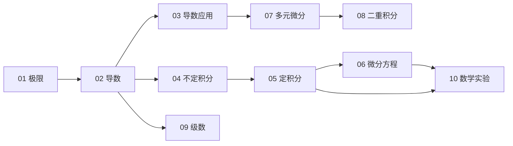

# 学习路径：食品专业高数十步走

面向食品类专业专科起点，从零基础到能独立建模计算。全程约 80 小时，按每周 6–8 小时计，约 10–12 周。

## 路径总览

## 步骤 01：极限地基

**目标**：能算常见极限，能判断连续与间断。
**阅读**：ch01-函数极限连续.md
**检查点**：自测 ≥80%；能独立算出 $\lim_{x\to0}\frac{\sin3x}{x}=3$。
**复习**：抽认卡标签「极限」「连续」。

## 步骤 02：导数与微分

**目标**：能用定义算导数，能套四则与链式法则，能做线性近似。
**阅读**：ch02-导数与微分.md
**检查点**：$\sqrt{1.02}\approx1.01$ 能口算并说明误差来源。
**复习**：标签「导数」「求导」「微分」。

## 步骤 03：中值定理与最优化

**目标**：能证简单不等式，能求单调区间与极值，能解最省料/最大利润问题。
**阅读**：ch03-中值定理与导数应用.md
**检查点**：独立完成"无盖方盒容积最大"与"圆柱罐表面积最小"两题。
**复习**：标签「中值定理」「极值」「凹凸」。

## 步骤 04：不定积分

**目标**：能默写基本积分表，能完成凑微分、第二类换元、分部积分。
**阅读**：ch04-不定积分.md
**检查点**：20 道基础积分题正确率 ≥85%，答案全部带 $+C$。
**复习**：标签「积分」。

## 步骤 05：定积分及其应用

**目标**：能用 N-L 公式计算，能判断反常积分，能用微元法求面积、体积、平均值。
**阅读**：ch05-定积分及其应用.md
**检查点**：能算 $\int_0^{30}1.8e^{-0.015t}dt=43.5$ 并解释它的物理含义。
**复习**：标签「定积分」「反常积分」「应用」。

## 步骤 06：微分方程

**目标**：能识别并解可分离、齐次、一阶线性、二阶常系数四类方程；能建冷却与增长模型。
**阅读**：ch06-微分方程.md
**检查点**：能独立推出牛顿冷却解并算出 30 min 后温度。
**复习**：标签「微分方程」。

## 步骤 07：多元微分

**目标**：能求偏导、全微分、复合与隐函数偏导，能用拉格朗日乘数法解约束优化。
**阅读**：ch07-多元函数微分学.md
**检查点**：能完成成本—蛋白含量约束下的配方优化。
**复习**：标签「多元」。

## 步骤 08：二重积分

**目标**：能画区域、定限、换序，能用极坐标算圆域积分。
**阅读**：ch08-二重积分.md
**检查点**：独立算出 $\int_0^1dx\int_x^1e^{-y^2}dy$。
**复习**：标签「二重积分」。

## 步骤 09：无穷级数

**目标**：能判断几何、p、正项、交错级数的敛散，能写泰勒展开并估误差。
**阅读**：ch09-无穷级数.md
**检查点**：能说明为什么调和级数发散、为什么 $\sum(-1)^{n-1}/n$ 是条件收敛。
**复习**：标签「级数」。

## 步骤 10：数学实验

**目标**：能用 Python 或 MATLAB 做数值积分、ODE 求解、最小二乘拟合，能正确记录有效数字。
**阅读**：ch10-数学实验与误差分析.md
**检查点**：用一组自测数据完成指数拟合，报出 $k$、$R^2$ 与有效位数。
**复习**：标签「数值」「拟合」「误差」。

## 学完全程后

你能：

- 把食品工艺中的变化过程翻译成函数、导数或微分方程；
- 用积分算总量、平均值、残留量；
- 用最优化方法决定配方、工艺参数、包装尺寸；
- 用软件完成数值计算，并判断结果能信到第几位。

综合检验：见 `quiz.md` 的"最终检验"，选一个熟悉的工艺完成建模、计算、误差说明三件事。
